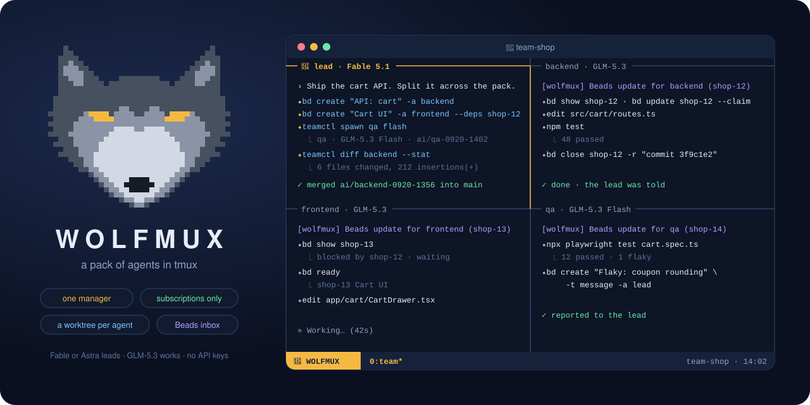
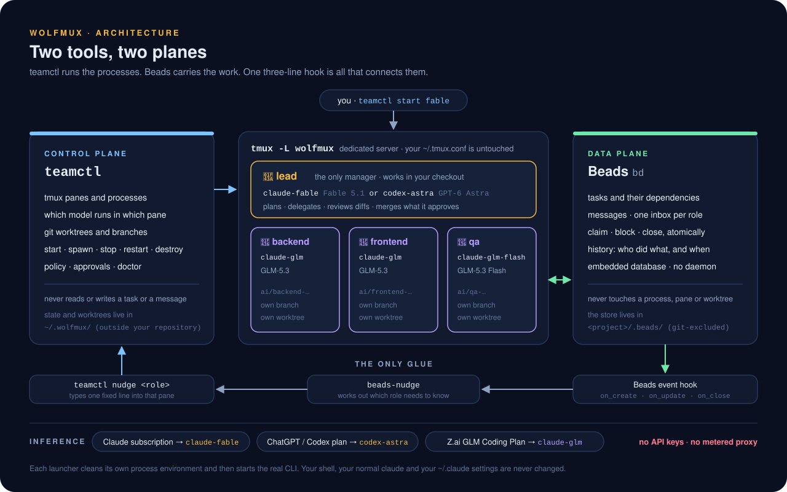

# Wolfmux



A local, multi-model AI development team on one Mac. One **lead** agent plans,
delegates and reviews; any number of **worker** agents implement in parallel. Every
agent is a real CLI in its own visible tmux pane, on its own git branch and worktree.
The lead is the wolf — 🐺 in its pane border, an amber frame, the large pane on the left —
and every teammate is a dog of the pack (🐶), so you can always tell the manager from the rest.

**Inference runs on subscriptions: the Claude, ChatGPT and coding-plan keys you
already have. Two providers are pay-as-you-go APIs (Moonshot's platform, DeepSeek);
they refuse to run until you store their key and set `WOLFMUX_METERED=on` yourself.
No metered proxy, ever.**



## What you get

| | |
|---|---|
| **Any model in any seat** | Fable, Opus, Sonnet, Haiku, GPT-6 Astra, GLM-5.3 and GLM-5.3 Flash, plus the provider keys `kimi`, `moonshot`, `deepseek`, `minimax`, `qwen`, as lead or as teammate, mixed freely in one team ([models](#models)) |
| **Several teams per project** | the first is called `default`, every further one is named by you; each has its own session, lead and teammates; `teamctl status` shows them as a tree. Teams message each other through Beads, and a lead can found a fresh team and hand work over to it, and recover or delete it if its lead dies ([diagram](docs/diagrams/teams.svg)) |
| **One worktree per teammate** | its own branch and checkout, outside your project. A guard refuses a teammate's tool calls that change your checkout, read another teammate's worktree, switch or delete branches, push to main or drive tmux (Claude Code teammates; Codex has no such hook) |
| **You always find the manager** | the 🐺 lead is the amber pane on the left, 🐶 teammates are stacked on the right. A desktop notification tells you when an agent finishes, and clicking it opens the team |
| **Nothing is lost by accident** | `stop` and `destroy` keep worktrees, branches and commits. `remove` refuses while a teammate holds uncommitted or unmerged work, and lists it. `destroy --purge` shows each worktree's size, that same list and the total it frees, and asks before it deletes |
| **Subscriptions by default** | every launcher first removes inherited API keys and endpoint overrides from its own process, then starts its CLI; a provider's endpoint and model mapping exist only inside the launcher it belongs to, for that process only; every provider key lives in the Keychain, one service per provider; the two metered providers refuse to run until the owner sets `WOLFMUX_METERED=on` (`teamctl doctor` reports on all of it) |

## Quick start

```bash
git clone <this repo> ~/Documents/wolfmux && cd ~/Documents/wolfmux
./install.sh                                  # idempotent; backs up what it edits
security add-generic-password -U -s zai-coding-plan -a "$USER" -l "Z.ai Coding Plan API key" -w
teamctl doctor                                # no "!! WARNING !!" lines = ready

cd ~/code/your-project
teamctl start                                 # a new lead runs Opus; Fable only when asked: teamctl start fable
teamctl spawn backend glm53
teamctl spawn qa flash
teamctl start --team review                   # a further team in the same project, named by you; teamctl status shows them all
teamctl spawn fe-review astra                 # any model can join any team (fable · opus · sonnet · haiku · astra · claude:<id> · codex:<id>)
teamctl spawn review kimi                     # …and the provider keys: kimi · moonshot · deepseek · minimax · qwen
```

Then talk to the lead. It creates tasks and messages in Beads, spawns workers,
reviews their diffs with `teamctl diff <role>` and integrates what it approves.

## Commands

One command, `teamctl`, run inside your project. `teamctl help` prints this list;
[docs/USAGE.md](docs/USAGE.md) walks through a full session. With several teams in one
project, add `--team <name>` to any command (before or after it); with one team you never
need it. Tasks and messages are not teamctl's: they are Beads
([`bd` cheat sheet](docs/USAGE.md#beads-cheat-sheet)).

**Teams**

| Command | Does |
|---------|------|
| `teamctl start [<model>] [--team <name>] [--no-attach] [--continue] [--resume <session-id>]` | start a team and open it. With no model: an existing lead keeps its recorded model; a new lead gets policy `lead-model` (default Opus). Fable only when asked: `teamctl start fable`. `--team` names a further team in the same project; `--continue` resumes the lead's **own** conversation (the id stored with it), `--resume` reopens the one you name; after the lead quit, the same command brings it back |
| `teamctl start … [--ticket <KEY>] [--init-beads\|--skip-beads] [--lead-permissions skip\|ask] [--worker-permissions skip\|lead\|ask] [--worker-spawn on\|off]` | `--ticket` is the team's default ticket key, used by a branch template that asks for one; `--init-beads` or `--skip-beads` answers the first start's question about Beads; the other three set the team's policy, at any start |
| `teamctl start <model> --team <new> --handover <bead-id>` | found a fresh team whose lead starts by reading that bead. A lead may run this too; you are notified. While that lead runs, the founder does not manage the team; once it is not running the founder may `restart`, `stop`, `remove` or `destroy` it, and `start <model> --team <it> --continue`; you are told each time |
| `teamctl status [--json]` (alias `workers`) | every team as a tree (one team with `--team`, or from inside a pane): 🐺 lead, 🐶 teammates, model (the one the agent runs, the same answer `teamctl models` gives; a `*` after it means its last answer names that model and its record does not vouch for it), running or stopped (or `backgrounded`: the pane runs Claude's agent view, with a hint naming the background chat its conversation continued in), branch, commits ahead, uncommitted files, and CONTEXT: what each agent's conversation holds (tokens, and the share of the window when the model's window is known, from the transcript of its own conversation; a model whose window is not known shows the tokens with no percentage, never a guessed share). A team without a running lead says it is orphaned and who may act on it; `--json` has `founder`, `orphaned`, `session_id`, `context_tokens`, `context_window` and `requests`, and per agent `model_id` (the id it runs), `recorded_id` (the id on its record) and `known_from` (`record`, `transcript` or `unknown`) |
| `teamctl teams [--json]` | the short list: state (`running`, or `orphaned` when its lead is not running), lead, number of agents, the disk its teammates' worktrees take, and who founded it. Under the table, each orphaned team says who may act on it: you, and the lead that founded it |
| `teamctl attach` (alias `open`) | open the team in this terminal (`Ctrl-b d` leaves it running) |
| `teamctl dashboard [--json] [--once] [--interval <seconds>] [--full]` | EVERY team on this machine, across every project, in one read-only view, and `prefix O` opens it as a popup (`q` closes it). Per agent: state, the CPU and memory of its whole process tree, context use, when its transcript was last written, branch. Per team: totals, state, lead, and the cached lane disk. At the foot: the machine's load, free memory and free disk. `--once` prints it and exits, `--interval` sets the redraw (default 5 s), `--full` also reads context and the transcript time for agents that are not running (slower), and `--socket <path>` asks that tmux server rather than the default one (the key binding hands its own over; the socket is never guessed). It never runs `du`: lane totals are the number `teamctl teams` left behind, and the view says so when that number is stale |
| `teamctl focus <role>` | jump to one pane |
| `teamctl layout [lead-left\|lead-top\|tiled]` | how the panes are arranged; `lead-left` is the default |

**Teammates**

| Command | Does |
|---------|------|
| `teamctl spawn <role> <model> [--base <ref>] [--branch <name>] [--ticket <KEY>] [--repo <path> \| --from-worktree <role>] [--no-kickoff] [--resume <session-id>] [--link-node-modules]` | a new 🐶 teammate with its own pane, branch and worktree. Any model, whoever leads. Refused when free disk is under `disk-min-gb` (policy `disk-guard`). `--branch` names the branch exactly; `--ticket` supplies the key a [branch template](#branch-names-and-other-repositories) asks for; `--repo` puts the worktree and the branch in **another** git repository, with the guard still on. `--from-worktree <role>` gives the fresh teammate the stopped worker's built worktree, on a new branch (its branch and commits stay), so node_modules and build output survive and no install or build is repeated — **provided that lane was protected before it was parked**: from v1.17.0 `teamctl stop` sweeps a lane's build output, so run `teamctl keep <role>` first for a lane you mean to hand over. The flag travels with the worktree to the new role, and the handover line says which of the two happened. The worktree must be clean; the work is refused and listed otherwise (`--repo` does not combine with it: the worktree stays in its own repository). Only the lead, or you, may hand a worktree over; a worker is refused (exit 77) even with worker-spawn on. `--resume <session-id>` puts it into an existing conversation instead of a new one, and sends no kickoff. `--link-node-modules` points a brand-new lane's `node_modules` at its repository's copy instead of installing 2+ GB of its own — one directory for every lane, so an install in any lane changes them all |
| `teamctl stop <role>` | close its pane; worktree, branch and commits stay. Its build caches (`.next`, `dist`, …) are deleted, `node_modules` is kept, so `restart` stays cheap |
| `teamctl restart <role> [--model <model>] [--continue] [--resume <session-id>]` | start it again in the same worktree on its recorded model, or record and use `--model`. `--continue` keeps its own conversation, `--resume` reopens the one you name (`teamctl status --json` prints each agent's `session_id`); both require the same CLI family. When the team's tmux session is gone (a reboot), `restart lead` starts the team again |
| `teamctl model <role> <model> [--team <name>] [--now]` | record the model for the next start, restart or restore. `--now` also switches a Claude agent by a resume-restart, keeping its conversation, when it is between turns and nobody is at its pane; otherwise it records the choice and explains why the switch waits. It does not change `~/.claude/settings.json` |
| `teamctl policy lead-model <model>\|default` | the human's choice of default for new leads in this project (Opus unless `WOLFMUX_LEAD_MODEL` says otherwise). `default` returns to the config value. Existing teams keep their lead's model |
| `teamctl memory [status]` · `teamctl memory enable <team>` · `teamctl memory adopt <team>` · `teamctl memory disable` · `teamctl memory path` · `teamctl memory check` | **team memory**: ONE team's lead keeps a private memory folder, `~/.wolfmux/memory/<project>/<team>/`. `status` (anyone): which team, the folder's size, the `MEMORY.md` index against its 25,000-byte cap, whether the running lead was started with it; never what a note says, and the folder's path and the lead's conversation id only to the human and that lead. `path` and `check` (which writes the index and prints names) are the human's and that lead's only (exit 77 for anyone else). `enable` is the human's alone (an agent gets exit 77): it sets policy `team-memory`, creates the folder (mode 700) from the installed skeleton and runs `mem init`; an existing folder is kept. It refuses a team an agent founded: `adopt` (the human's alone) makes the human its founder first, logged. `disable` (the human or that team's own lead) only sets the policy off; nothing is deleted. Every change reaches a running lead at its next restart |
| `teamctl policy team-memory <team>\|off` | the same as `teamctl memory enable <team>` / `disable`. That lead gets the folder as Claude Code's `autoMemoryDirectory`, a short "Team memory" block in its system prompt (the folder and its rules, never the card: `ps` and `teamctl _prompt` show a prompt to anyone) and a first prompt that runs `mem boot` at every launch, which prints the card. Only a team the human founded, with a runnable `bin/mem`, gets it. While it is on, every lead's `--continue` needs a stored conversation id (all leads share one transcripts folder). Only the human captures that lead's pane, for as long as the running lead holds the memory. Workers are refused the folder by the worktree guard ([docs/SECURITY.md](docs/SECURITY.md#team-memory-who-can-read-a-leads-private-folder)) |
| `teamctl remove <role>… [--force] [--yes]` | take a stopped teammate off the books: worktree, branch, record, and the gigabytes they held. Refuses while it holds work that exists nowhere else, and lists it; `--force` discards it after one question |
| `teamctl nudge <role>\|--all [--id <bead-id>] [--quiet]` | re-send the one-line notification into a pane. The Beads hook does this by itself. A pane somebody is typing in is left alone: the notice waits for it to go idle (`deferred: …`, exit 3). Your own lead pane is not typed into at all while you are watching the team: the notice is filed instead (`filed: …`, exit 4) |
| `teamctl inbox [<role>] [--all] [--json] [--keep]` (alias: `notices`) | for debugging: the pane notices filed for a role, newest last. Default: the lead of this team. Not counted in the status bar; reading them does not change whether the agent has had them. `--all`: every role of the team. `--keep`: leave them marked new. This is the short notices, NOT an agent's Beads inbox — the work itself is always `bd list --assignee <role> …`. Your own messages are `prefix N`, or a click on the `📨` number |

**Reviewing work**

| Command | Does |
|---------|------|
| `teamctl diff <role> [--stat\|--names\|--commits\|--working]` | a teammate's changes since its base |
| `teamctl worktrees` | branch, commits ahead and uncommitted files per teammate |
| `teamctl capture <role> [-n\|--lines <count>] [--all]` | recent terminal output of a pane, for diagnosing a stuck agent |
| `teamctl log <role>` | its full scrollback |
| `teamctl panes` | what tmux reports per pane: command, pid, directory |

**Policy and approvals**

| Command | Does |
|---------|------|
| `teamctl policy [<key> <value>]` | show or set, per team: `lead-permissions` skip\|ask · `worker-permissions` skip\|lead\|ask · `browser-writes` ask\|allow (DEFAULT ask; allow writes an explicit `permissions.allow` rule for `mcp__claude-in-chrome__*` into every agent's settings, lead and workers alike) · `worker-spawn` on\|off · `worker-isolation` on\|off (the worktree guard) · `lead-teams` on\|off (may the lead found teams) · `branch-template` (how this team names its workers' branches) · `human-pane-typing` off\|idle (type a notice into a pane you are watching? default off; yours alone to change) · `lead-wake` unwatched\|off (may an idle lead wake itself for a notice while you are not using its pane? default unwatched; yours alone to change) · `orphan-steward` <team>\|off (for the whole project: whose lead may restart or stop a team you founded while its lead is not running; default off; yours alone to change) · `disk-guard` refuse\|warn\|off · `disk-min-gb` a whole number of GB (0 = no limit) · `link-node-modules` on\|off · `auto-prune` on\|off (DEFAULT on: sweep a lane's build output as soon as the lane is parked; `teamctl keep <role>` protects one lane) · `auto-reclaim` on\|off (DEFAULT on: take a parked lane off the books by itself once its task is closed and its work is all in main; `teamctl keep <role>` protects one lane, and a value that is neither on nor off counts as off) |
| `teamctl approvals [--all]` | teammates' permission requests waiting for the lead (`worker-permissions lead`) |
| `teamctl approve <id>…\|--all` | allow them |
| `teamctl deny <id> "<reason>"` | refuse one, with the reason the teammate is shown |

**Disk**

A lane worktree is cheap to make and expensive to keep: on one project here each one
carried 2.3 GB of `node_modules`, 0.9 GB of `.next` and half a gigabyte of copied assets,
nothing ever removed any of it, 27 parked lanes reached 65 GB, and the machine filled its
disk and rebooted with every team's work in flight. So teamctl cleans up after its own
worktrees.

| Command | Does |
|---------|------|
| `teamctl prune [--team <name>] [--all-teams] [--dry-run] [--keep-node-modules]` | take the build output of every **parked** lane of the team: `node_modules`, `.next`, `dist`, `.turbo`, `build`, `coverage`, `.cache`, `.parcel-cache`, `.vite`, `.svelte-kit`, `.nuxt`, `target`. One line per lane and a total in GB. A **running** lane is never touched, nor is anything git tracks, nor a lane that holds other uncommitted or untracked files — that one is skipped and named. `--dry-run` reports and deletes nothing (anyone may run it; the real thing is the lead's). `--keep-node-modules` takes the build caches only. `--all-teams` does every team of every project on this machine, with a total per team and one for the machine — **yours alone to run**, from your own terminal: a lead has no standing outside its own team and is refused with exit 77 |
| `teamctl stop <role>` | parks the lane **and sweeps its build output**, the whole list above (policy `auto-prune`, on by default). The lane installs again before its tools run; `teamctl policy auto-prune off` keeps `node_modules` instead, which is what `stop` did up to v1.16.1 |
| `teamctl reclaim [--team <name>] [--all-teams] [--dry-run]` | take every **finished** parked lane of the team off the books: worktree, branch and record. A lane is finished when its task is closed in Beads, its branch's content is in main or the integration branch (merged, cherry-picked or squashed), nothing in it is uncommitted or stashed, and `gh` shows no open pull request on its branch. A check that cannot be answered keeps the lane. One line per lane: `removed`, or `holding` with the reason. `--dry-run` deletes nothing and anyone may run it. `--all-teams` does it for every team of every project on this machine and is **yours alone to run**: a lead gets exit 77. Parking a lane does all of this by itself (policy `auto-reclaim`, on by default) |
| `teamctl finish [--team <name>] [--dry-run]` | the lead (or you) says the team is **done**. It parks every lane, takes every lane that passes the gates of `teamctl reclaim` (whatever `auto-reclaim` says; `teamctl keep` still protects), and when no lane is left and no task of the team is open in Beads, it takes the team too: records, state directory, session. A line for it goes into `~/.wolfmux/state/reclaimed.jsonl`, with the lead's conversation id; transcripts are never deleted. If something still holds the team, the session ends anyway, the team stays, and `teamctl teams` says why; the next `teamctl reclaim --all-teams` finishes it once nothing holds it. **Only `finish` ever takes a team**: a lead that stopped, crashed or ran a plain `destroy` never counts. `--dry-run` deletes nothing and anyone may run it |
| `teamctl keep [<role> [on\|off]]` | never sweep or reclaim that lane automatically — for a checkout that is expensive to rebuild (a long install, a downloaded model, a seeded database), or a worker you mean to restart. `teamctl prune` and `teamctl reclaim` honour it too; `teamctl remove <role>` is still how the lane goes. With no role: what is protected right now |
| `teamctl remove <role>` · `teamctl destroy --worktrees` | all of it: the worktree is going away anyway |
| `teamctl destroy` (without `--worktrees`) | ends the session and keeps the worktrees, so it parks every lane — and therefore sweeps every lane, one line each, and asks every lane whether it is finished: a finished one is reclaimed, every other one says what it is holding |
| `teamctl status` | free disk, what this team's lanes take, the spawn guard, whether auto-prune and auto-reclaim are on, and under every parked lane that could not go: `holding <size>: <reason>` |
| `teamctl teams` | **measures** the lanes (a `du` per lane, seconds on a busy machine), the parked ones among them. `teamctl status` and the status bar's `held` field read the numbers this leaves behind and never measure, so both stay instant |
| `teamctl bar [--explain]` | the one line tmux shows in `status-right`, and with `--explain` a legend naming every field of it |
| `teamctl heavy [--timeout <seconds>] [--quiet] <command>...` | run something heavy — a test gate, a measurement, a long build — while holding the machine's heavy lock, so nothing else heavy runs beside it and no lane is swept while it does. It returns the **command's** exit status and says what it waited for. `--timeout` gives up after that many seconds (exit 75) instead of waiting; `--quiet` says nothing about waiting. Only one voice speaks about the lock: `lockf`'s own "already locked" line is silenced, the command's own output never is. **Use this instead of `lockf` by hand** — see the box below for what a bare `lockf` does to the lock |

Every sweep is written down in `~/.wolfmux/state/reclaimed.jsonl`, one JSON object per line:
when, which team of which project, which lane, how many kilobytes, what took them and what
it took. It is the answer to "where did that space go", long after the team is gone. A lane
that was taken off the books is a line there too (`"event": "lane-removed"`), with its
branch, the full sha that branch was at, why it was allowed to go and the commit that proved
its content is in main — whichever command took it.

A lane **mid-build** is never swept. A build runs in whatever shell started it, not in the
lane's pane, so `stop` cannot see it; the signal is the lock this machine's heavy runs
already hold. Take it with `teamctl heavy <command>` and nothing else is needed. While it is
held, parking a lane keeps its build output and says so. The file merely existing is not a
lock, so only trying to take it answers the question — which the sweep does read-only, with
`-k -n`, so that looking at the lock leaves the lock exactly as it was.

> **If you take it by hand, every holder must pass `-k`** (`lockf -k ~/.wolfmux/machine-heavy.lock <command>`),
> which is the whole reason `teamctl heavy` exists: it cannot be written the wrong way.
> `lockf`'s default is to DELETE the file when its command
> ends, and BSD locks live on the inode, not on the path. One holder that omits `-k` unlinks
> the file on exit, and from then on a holder still running sits on the old inode while every
> later holder and every probe gets a fresh one and succeeds — mutual exclusion is gone for
> everybody, silently. Measured here on 2026-10-13: a live holder had inode 240542083 open
> while the path resolved to 240709857, and a probe of the path answered "free". The hole is
> in the convention, not in the probe: nothing a single process can do recovers the lock once
> the file has been unlinked under it. `lockf`'s own manual recommends `-k` for this reason.

Most of a lane is not build output: measured on one machine, of 25 GB across 38 lane
worktrees only about 4 GB sat in a directory on that list — the rest is the checkout itself,
copied into every lane. `prune`'s "still held" line is that floor plus the whole of every
lane it skipped or left running, and says that `teamctl remove <role>` is what gives back
the part git tracks.

Up to v1.16.1 `stop` deliberately kept `node_modules`, so a lane parked for a week kept it
for the week unless somebody ran `prune` — and nobody did: 90.3 GB sat under
`~/.wolfmux/worktrees` on this machine, 50.9 GB of it build output (measured 2026-10-13).
A command nobody runs reclaims nothing, so from v1.17.0 **parking a lane sweeps it**.

**A finished lane takes itself off the books.** The sweep gives back build output; the
checkout itself is the bigger half (33.3 GB of the 52.6 GB left after a full sweep, measured
2026-10-13) and only `teamctl remove` gave that back. So when a lane is parked — `teamctl
stop`, or a plain `teamctl destroy` — every parked lane of the team is asked whether it is
finished, and a finished one goes: worktree, branch and record. All of these have to hold,
and **a check that cannot be answered keeps the lane**:

| Gate | What is asked | The lane stays, and says |
|------|---------------|--------------------------|
| parked | tmux and the record: is it running? Not knowing counts as running | nothing: a running lane is working, not holding |
| not protected | `teamctl keep <role>` | `teamctl keep protects this lane` |
| nothing uncommitted | `git status`: no change to a tracked file, no untracked file that is not build output | `dirty: 2 uncommitted files` |
| HEAD on its branch | is the worktree's HEAD the tip of the lane's branch? A detached HEAD holds commits no branch leads back to | `its worktree is at 6c3143f, which is not the tip of its branch` |
| content in main | is everything on the branch in main, in `origin/main`, in the branch the lane was cut from, or in the branch checked out in your repository? Merged, cherry-picked and squashed all count | `unpushed at 6c3143f` when the tip is on no remote, `unmerged at 6c3143f` when it is |
| nothing stashed | was a stash entry made on this lane's branch? | `2 stash entries on its branch, newest 7be8ca3` |
| task closed | Beads, by the lane's own name: no task that is not closed, and at least one that is | `task open (fp-12)` · `no task bead on record` · `cannot ask Beads (…)` |
| no open PR | `gh pr list --head <branch> --state open` | `open PR #41` · `cannot ask GitHub (…)` |

`teamctl status` prints that reason under the lane, with what the lane takes on disk:
`holding 1.9 GB: unmerged at 6c3143f`. Unreclaimable is acceptable; invisible is not.

Three things about it that are easy to get wrong:

- **A squash is seen, and plain `git cherry` would not see it.** `git cherry` compares commit
  by commit, so three commits squashed into one read as three commits that are nowhere
  (measured on git 2.50.1: three `+` lines, and `git branch --contains` says the same). So
  one throwaway commit is built that holds the branch's whole diff, and `git cherry` is asked
  about that. **The known limit:** if main changed a line next to one of the branch's hunks
  before the squash, the two patches differ in their context, nothing matches, and the lane
  is **kept** as unmerged. It errs toward disk, never toward work; `teamctl remove <role>` is
  how such a lane goes.
- **A stash does not die with its worktree**, so that is not why a stash keeps a lane.
  `refs/stash` is one list for the whole repository (measured: an entry made in a lane was
  still listed, and its commit still there, after the lane's worktree and branch were
  removed). A stash made on the lane's branch keeps the lane because it is work the "content
  in main" gate cannot see — a stash is not a commit on the branch — and once the branch is
  gone the entry names a branch that no longer exists, in a list nobody reads. Nothing is
  lost either way. A stash made on a detached HEAD belongs to no lane: it keeps none, and
  `teamctl reclaim --dry-run` names it once per repository.
- **Content that is only in a main you have not pushed still counts.** teamctl never deletes
  main, so that work is not at the risk a lane is. The line says so — `content in main
  (merged, at 1a2b3c4; main is not pushed)` — so that the record does not imply a safety that
  is not there.

Before the branch goes, where it was is printed and written down:
`sam: branch ai/review/sam-20261013-101500 was at <full sha>`. Every command that takes a
lane does that now — `reclaim`, `remove`, `destroy --worktrees` and `destroy --purge` —
because a sha in the record
is the difference between `git branch <name> <sha>` and an evening with `git fsck`.

**What changes for a lead:** `teamctl stop` on a worker whose task is closed and whose work is
merged removes that lane, record and all, so `teamctl restart` on it is gone. Run
`teamctl keep <role>` before stopping a worker you mean to bring back, or switch it off for
the team with `teamctl policy auto-reclaim off`. A team whose lead is gone has nobody left to
park a lane; `teamctl reclaim --all-teams`, from your own terminal, is what reaches those.

**A team whose lead is not running says why it is still here.** `teamctl teams` puts one
line under each orphaned team: what it holds, how its lead's last session ended (`lead
stopped itself 11:00Z`, or `no record of how the lead ended (crash, kill or reboot)`), how
many of its tasks are open, and which lanes hold and why. The status bar shows `orph N` when
there are any, and the dashboard shows `orphaned teams: N holding X`. Such a team is never
deleted for being quiet: a crashed lead and a finished one look the same from outside, so
only `teamctl finish` ends a team.

`teamctl remove` refuses a lane that holds commits or files somebody wrote, and build output
is not that: a `node_modules` (the `--link-node-modules` symlink included), the build caches
and wolfmux's own cleanup trash are swept without a question. `build`, `dist` and `target`
are the exception — when git neither tracks nor ignores one of them, remove asks, because a
handwritten `dist/deploy.sh` lives exactly there.

What is never deleted: a source file, a commit, git state, anything git tracks (a project
that commits its `dist` keeps it), a worktree with uncommitted changes, your own checkout.
A lane that lost its `node_modules` needs one `npm install` before its tools run again;
nothing else of it changes. Each directory is renamed inside its own worktree before it is
deleted, so a cleanup killed halfway leaves a `.wolfmux-removing-*` directory that the next
run clears, never a half-deleted `node_modules` that looks installed.

**Ending, deleting, checking**

| Command | Does |
|---------|------|
| `teamctl destroy [--worktrees] [--yes]` | end the team. Every worktree is kept; `--worktrees` also removes teammates that hold nothing, and takes the build output of all of them first |
| `teamctl destroy --purge [--force] [--keep-transcripts] [--memory] [--yes]` | the lead's memory folder (team memory) stays unless `--memory` is given. `--memory` is yours alone (the pane proof: an agent gets exit 77, even with a terminal), and asks you to type the team's name. Delete the whole team and give its disk space back: shows sizes and any uncommitted or unmerged work, asks, then removes the session, worktrees, the branches teamctl created, records and its teammates' Claude Code transcripts. `--force` deletes that work too. Never touched: your checkout, other branches, Beads, other teams, the lead's own conversations |
| `teamctl doctor [--probe]` | billing and credential isolation report: launchers, inherited keys, settings overrides, Keychain, logins. `--probe` also asks each provider whose key is set up whether its endpoint accepts it: one incomplete request each, nothing billed, only the HTTP status shown. Also the Beads store: its mode, journal and index size, whether it was ever compacted, and how long one bd call takes; past 1 GB of journal, 20 MB of index or 1.5 s a call it prints the compaction command (wolfmux never runs it). It warns about a `claude daemon run` process that carries an agent's identity (TEAM_ROLE, WOLFMUX_TEAM, BEADS_ACTOR; no other variable is printed), with the pid that started it and how to clear it; it never stops it |
| `teamctl models [--json] [--refresh]` | what `fable`, `opus`, `sonnet` and `haiku` mean today: alias, model id, label ("Opus 5.5") and where the id came from (a config pin, today's probe, the built-in id), then the model each running agent runs, where that is known from (`record`, or `transcript` when its record does not vouch for it) and the restart that moves it to a newer one. `--refresh` asks Claude Code again now. See [Always the newest model](#always-the-newest-model) |
| `teamctl version` · `teamctl help` | |

### Always the newest model

`fable`, `opus`, `sonnet` and `haiku` follow Claude Code's own aliases, which Claude Code
documents as "an alias for the latest model". With `WOLFMUX_MODEL_POLICY=latest` (the
default) teamctl asks Claude Code what an alias means for your account the first time an
agent starts on it each day: one tiny print-mode call, cached in `~/.wolfmux/models/`, never
made by `status`, the status bar or `doctor`. A new release (Opus 5.5 after Opus 5) reaches
new agents by itself. The id an agent starts on is written to its record, so its label is
right ("Opus 5.5"), and `teamctl doctor` and the status bar say when a running agent is on
an older model, with the `teamctl restart <role> --continue` that moves it. Nothing restarts
by itself. If the call fails, the built-in id is used and every spawn warns.

A pin wins: `WOLFMUX_OPUS_MODEL=<id>` in `~/.config/wolfmux/config` means that id until you
delete the line. `WOLFMUX_MODEL_POLICY=pinned` keeps the built-in ids of this release.

**One answer in every view.** Which model an agent runs is worked out in one place, and
`status`, `teams`, the dashboard, `models` and `doctor` all show that answer. It is the id
on the agent's record. When the record has no id (an agent started before v1.18.0), or the
agent's last answer names another model (Claude Code fell back to an earlier one at startup,
or `/model` changed it in the session), the answer is the model its transcript names, and
tables mark an unrecorded answer with a `*` (`known_from: transcript` in `--json`). A later
answer from another Claude family is adopted on the next `status`, `teams`, or `restart`
read, so restart and restore keep that model. Adoption needs an existing model id, an
answer newer than the last recorded model change, and the project lock; a busy lock leaves
it for the next read. Right after
`teamctl restart <role> --continue` the record is the newer word: the conversation still
ends with the old model's answer, and that answer says nothing about the new start. The
context share is of the window Claude Code declared for that very model. If nobody can
name the model (`Opus ?`), or nobody declared a window for it, you see the tokens and no
percentage: a share is never taken of another model's window. The status bar and shell
completion read the record only, for speed, and say `?` or `unknown` where it has no id.

`start`, `stop`, `restart`, `model`, `remove`, `destroy`, `approve`, `deny` and changing the `policy`
are for you and for the team's lead; a teammate that tries them is refused (exit 77).
From v1.21.1 an agent is who it says it is only inside its own pane: a chat that merely
inherited an agent's environment (for example a Claude background chat started from a lead's
pane) gets no notices, is told on every prompt that it is not that agent, and is refused
(exit 77) on every command that checks who may act. Every Claude agent also runs with Claude
Code's agent view off, so `/bg` cannot do this; a running agent gets that at its next restart.
The project-wide `lead-model` policy is for the human only. For example, the human chose
Fable for deployment-manager's lead: `teamctl model lead fable --team deployment-manager`.
That is a team choice, not a built-in exception. See the [manual](config/wolfmux/README.md#choosing-a-leads-model)
for switching models and the global settings side effect of typing `/model` in Claude.

### Tab completion

After `./install.sh`, a new zsh terminal completes `teamctl`: the commands with short
descriptions, the options of each command, and the values teamctl knows - roles,
teams, models, policy keys and their choices, layouts, pending approval ids, local
branch names.

```bash
teamctl <Tab>                 # the commands (teamctl re<Tab> offers remove and restart)
teamctl restart <Tab>         # the roles of your team (remove offers workers only)
teamctl spawn x <Tab>         # the models, with their labels
teamctl --team <Tab>          # the teams of this project
teamctl policy <Tab>          # the policy keys; teamctl policy worker-spawn <Tab> the choices
```

The knowledge lives in one backend inside teamctl (`teamctl _complete`); the zsh and
bash shims in `~/.config/wolfmux/completion/` are thin and only present what it
answers ([ADR-0026](docs/adr/0026-tab-completion.md)). The zsh shim registers only
when a completion system is loaded (compinit): it never switches one on by itself.
To try it without install.sh: `source <(teamctl completion zsh)`. In bash:
`eval "$(teamctl completion bash)"` (bash 3.2 cannot source a process substitution). Tab offers nothing? See
[TROUBLESHOOTING.md](docs/TROUBLESHOOTING.md#tab-completion).

### Claude Code slash commands

`./install.sh` puts a Claude Code slash command per `teamctl` command you run by
hand into `~/.claude/commands/`, so they work in every project, not just this one:

```
/teamctl <args>         passthrough: runs teamctl $ARGUMENTS and prints the output
/team-status [--team X] /team-teams  /team-dashboard  /team-inbox  /team-approvals
/team-models [--refresh]          what fable/opus/sonnet/haiku mean today, and who runs an older model
/team-nudge <role> [--team X]
/team-spawn <role> <model> [...]
/team-prune [--dry-run]           asks before running without --dry-run
/team-destroy <team>              shows teamctl teams, asks, then runs --purge --yes
```

Installed by content hash: a file already up to date is left alone, a stale copy of
wolfmux's own file is updated, and a file under the same name that you wrote yourself
is never touched — install.sh says so and names the file. Skip the whole step with
`./install.sh --no-claude-commands`.

### Branch names and other repositories

A teammate's branch is named by the team's **branch template**. The default reproduces the
names wolfmux has always used, `ai/<role>-<timestamp>` and `ai/<team>/<role>-<timestamp>`,
so nothing changes unless you change it:

```bash
teamctl policy branch-template 'feature-{ticket}-{role}-{ts}'   # this team, from now on
teamctl start fable --ticket AFD-1844                           # the team's default ticket key
teamctl spawn sam glm53 --ticket AFD-1844                       # feature-AFD-1844-sam-20260923-112233
teamctl spawn sam glm53 --branch feature-AFD-1844-sam           # or name the branch yourself
teamctl policy branch-template default                          # back to the built-in shape
```

Placeholders: `{team}` `{role}` `{ts}` `{ticket}`. `{ts}` is the timestamp and is required —
it is what keeps two teammates of the same role on two branches. A template with `{ticket}`
and a spawn with no ticket key is refused rather than guessed at (exit 64). Set this when
your repository's hooks require a shape, so teammates never have to commit with a skip
switch. `WOLFMUX_BRANCH_TEMPLATE` in `~/.config/wolfmux/config` is the default for every team.

teamctl deletes a teammate's branch (`teamctl remove`, `teamctl destroy --purge`) **only when
teamctl created it**, whatever it is called. A branch you made yourself is named and left alone.

A teammate can also work in a **different repository**:

```bash
teamctl spawn srv glm53 --repo ../fanpro-studio-server
```

Its worktree and branch are created there, from that repository's `HEAD` (or its `--base`),
under `~/.wolfmux/worktrees/<that repo>/teams/<team>/`. Worker isolation stays on and holds
that teammate to that worktree: both your project's checkout and the other repository's own
checkout are read-only for it. `teamctl status` (a `REPO` column, and `repo` in `--json`),
`diff`, `worktrees`, `remove` and `destroy` all run git in that repository, so what wolfmux
created there is also what wolfmux cleans up there.

### Models

For `teamctl start` and `teamctl spawn`:

| Key | Runs | Pays with |
|-----|------|-----------|
| `glm53` · `flash` | Claude Code + GLM-5.3 / GLM-5.3 Flash | Z.ai GLM Coding Plan |
| `kimi` | Claude Code + Kimi for Coding | Kimi for Coding subscription; the key is a Kimi Code membership key (Kimi Code console, starts `sk-kim`) |
| `minimax` | Claude Code + MiniMax M3 | MiniMax Coding Plan |
| `qwen` | Claude Code + Qwen 3.7 Plus | Alibaba Model Studio coding plan; the key starts `sk-sp-` |
| `moonshot` | Claude Code + Kimi K3 API | Moonshot platform API: metered, refuses to run until the owner sets `WOLFMUX_METERED=on`; the key comes from platform.kimi.ai |
| `deepseek` | Claude Code + DeepSeek V4 | DeepSeek API: metered, refuses to run until the owner sets `WOLFMUX_METERED=on` |
| `fable` · `opus` · `sonnet` · `haiku` | Claude Code + that Claude model | Claude subscription |
| `astra` | Codex CLI + GPT-6 Astra | ChatGPT subscription |
| `claude:<model-id>` · `codex:<model-id>` | any other model of those two subscriptions | the same subscription |
| `kimi:<id>` · `moonshot:<id>` · `deepseek:<id>` · `minimax:<id>` · `qwen:<id>` | any other model id of that provider (GLM is not pinnable: its plan covers exactly its two) | the same plan, or the same metered account |

The provider facts (endpoint, model ids, context window, billing) live in one table,
`config/wolfmux/lib/providers.sh`; `teamctl`, the launchers, `doctor` and this page all
read it ([ADR-0020](docs/adr/0020-providers-beyond-the-three-subscriptions.md)). Each
provider's key lives in its own Keychain service (`wolfmux-kimi`, …; Z.ai keeps
`zai-coding-plan`); `WOLFMUX_<PROVIDER>_MODEL` / `_FAST_MODEL` pin a model id when a
vendor changes it. `teamctl status` marks a metered agent with `$` after its label.

The two Kimi keys are not interchangeable, and both say "Kimi" and start with `sk-`. A
**Kimi Code membership key** (from the Kimi Code console,
[kimi.com/code/console](https://www.kimi.com/code/console), starts `sk-kim`) belongs to `kimi`.
A key created at [platform.kimi.ai](https://platform.kimi.ai/console/api-keys) belongs to
`moonshot`. Put one in the other's slot and the endpoint answers 401 while everything on your
side looks right. `teamctl doctor --probe` finds that in a minute: it sends one incomplete
request per key you stored (nothing is generated, nothing is billed), shows only the HTTP
status, and says `the key in 'wolfmux-kimi' is rejected by <endpoint>`. It also warns when a
`kimi` key does not start with `sk-kim` or a `qwen` key with `sk-sp-`. Plain `teamctl doctor`
stays offline and never reads a key.

### Auth modes

A provider worker gets its key one of two ways (`WOLFMUX_<PROVIDER>_AUTH_MODE` in
`~/.config/wolfmux/config`):

- `helper` (the default): Claude Code is given a command that reads the Keychain on demand, so the
  key is never in an environment. Every provider worker also carries an inert
  `CLAUDE_CODE_OAUTH_TOKEN` (the login guard), so Claude Code prints
  `Both CLAUDE_CODE_OAUTH_TOKEN and apiKeyHelper set: auth may not work as expected`. That warning is
  expected and harmless (the helper's key is what is sent). It is not the cause of a 401 next to it.
- `env`: the vendor's own variable (`ANTHROPIC_API_KEY` for Kimi Code, `ANTHROPIC_AUTH_TOKEN` for the
  others). A last resort, for an endpoint that refuses helper-mode headers. It cannot fix a wrong key.
  With `ANTHROPIC_API_KEY` set, Claude Code's own documentation says it asks whether to use the key
  ("Do you want to use this API key?", default No) and remembers the answer, so an unattended worker
  waits at that prompt until a human answers it in the pane. Claude Code documents no setting that
  pre-approves the key, and Wolfmux does not edit your `~/.claude.json` to answer for you, so there
  is nothing to switch on.

A 401 means the key first: run `teamctl doctor --probe` before changing the mode.

Behind the keys are launchers you can also run by hand: `claude-fable`, `claude-opus`,
`claude-sonnet`, `claude-haiku`, `codex-astra`, `claude-glm`, `claude-glm-flash`,
`claude-kimi`, `claude-moonshot`, `claude-deepseek`, `claude-minimax`, `claude-qwen`.
Each one first removes every inherited API key and endpoint override from its own
process; `claude-glm` then sets that provider's endpoint and model ids, for that
process only. Plain `claude` and `codex` keep their login, endpoint and model:
nothing global points anywhere.

## What is in this repository

| Path | What |
|------|------|
| `bin/` | `teamctl` and the three launchers (`claude-glm-flash`, `claude-opus`, `claude-sonnet`, `claude-haiku` and the provider names `claude-kimi`, `claude-moonshot`, `claude-deepseek`, `claude-minimax`, `claude-qwen` are symlinks the installer creates) |
| `config/wolfmux/notifier/` | source and icon of `Wolfmux.app`, the application `install.sh` builds so that clicking a notification opens the team |
| `config/wolfmux/` | everything installed to `~/.config/wolfmux/`: `lib/*.sh`, the Beads hook, the team tmux config, the agent protocol, the user manual, launcher settings |
| `claude/permissions.json` | the narrow allow/ask rules merged into `~/.claude/settings.json` |
| `codex/wolfmux.rules.template` | Codex execpolicy rules so an Astra lead can run `teamctl` and `bd` |
| `install.sh`, `uninstall.sh` | reversible installation |
| `migrate-from-ai-team.sh` | one-time move from v1.1 and earlier, when this was called "ai-team" ([why](docs/adr/0014-rename-to-wolfmux.md)) |
| `tests/` | `smoke.sh` (352 isolated lifecycle checks, no model calls), `disk.sh` (93 checks: the worktree cleanup, the spawn guard and every safety rule that keeps them off your work), `reclaim.sh` (134 checks: a finished lane is taken off the books and every lane with something still to lose stays, one gate at a time; stand-ins answer for `bd` and `gh`), `nudge-typing.sh` (61 checks: a notice never lands in a half-typed line), `inbox.sh` (107 checks: nothing is typed into the human's conversation while he is working in it, and the agent still learns about the bead even when it is idle), `dashboard.sh` (115 checks: the read-only view of every team on the machine, and the status-bar segment), `human-inbox-keys.sh` (73 checks: `prefix N` and `prefix O` really open their popups on tmux 3.7c, and the messages popup reads keys, not a terminal's focus reports and replies; v1.20.1), `providers.sh` (141 checks: the provider table — every provider's facts, keys and settings — and the config file's allowlist), `docs.sh` (does the documentation name every command, option, policy key, model and setting the code has), `permissions.sh` (what the installer does to `~/.claude/settings.json`, in a throwaway `HOME`), `models.sh` (22 checks: the newest model resolved at spawn, a pin that wins, one probe a day, the fallback warning, labels from the id, the drift check; a stand-in answers for Claude Code), `migration.sh` (the move from v1.1, same), `credential-routing.sh` (evidence for the billing/credential design). All nine measured at one commit on v1.16.1; `smoke.sh`'s figure is its clean shape (`HUP` and `INT` at their defaults — a detached launch skips one check per signal it leaves ignored), and `docs.sh` guards none of these numbers (see `docs/ROADMAP.md`) |
| `tools/` | `wolf-art.py` (the one pixel drawing behind the terminal wolf, the logo and the hero) and `flow-diagrams.py` (the sequence diagrams); only needed to change the artwork |
| `docs/` | the documentation below, and `docs/diagrams/` |

## After a reboot

After a reboot or crash, run `teamctl restore [--dry-run] [--yes] [--no-tabs]` from your
own terminal. It shows the teams it will restore and asks once (Enter continues). It
brings back their leads one at a time, sends each a Beads message and a nudge, then
opens their iTerm2 tabs in the saved order. `--dry-run` only shows the plan; `--yes`
skips confirmation; `--no-tabs` leaves attaching to you. Already running leads,
deliberately stopped teams and removed teams are skipped. Workers stay parked.
Claude leads without a stored conversation id are also skipped, with a command to
resume the right conversation by hand. Codex still uses `--continue`.

The status bar saves the running teams once a minute while a client is attached.
Restore waits for memory and load to settle before each start. If iTerm2 is unavailable
or Automation is refused, it prints the attach commands. Anyone may preview the plan;
only you, or the orphan steward for teams you founded in its project, may run it.
Policy `restore-on-limit` defaults to `report`: a lead blocked on a usage limit is
listed. Set `teamctl policy restore-on-limit opus` to restart it on that model instead.
The global default is `WOLFMUX_RESTORE_ON_LIMIT` in the config file. No login item is installed.

## Documentation

| Read this | To learn |
|-----------|----------|
| [docs/GOALS.md](docs/GOALS.md) | what this is for, the hard constraints, the non-goals |
| [docs/ARCHITECTURE.md](docs/ARCHITECTURE.md) | components, process and environment model, data flows, file layout |
| [docs/diagrams/](docs/diagrams/README.md) | every diagram on one page: architecture, several teams, billing isolation, how work travels, approvals, notifications |
| [docs/SETUP.md](docs/SETUP.md) | installing on a machine, what gets touched, updating, uninstalling |
| [docs/USAGE.md](docs/USAGE.md) | a full working session, command reference, the Beads cheat sheet |
| [docs/SECURITY.md](docs/SECURITY.md) | how subscription-only billing and credential isolation are enforced, with evidence |
| [docs/VERIFICATION.md](docs/VERIFICATION.md) | what was tested, how, and the results |
| [docs/BUILD-LOG.md](docs/BUILD-LOG.md) | the steps this system was built in, including what went wrong |
| [docs/TROUBLESHOOTING.md](docs/TROUBLESHOOTING.md) | symptoms and fixes |
| [docs/ROADMAP.md](docs/ROADMAP.md) | known limits and what a V2 could be |
| [docs/adr/](docs/adr/README.md) | the architecture decisions, each with alternatives and consequences |
| [config/wolfmux/TEAM_PROTOCOL.md](config/wolfmux/TEAM_PROTOCOL.md) | the rules every agent receives at launch |

## Requirements

macOS (uses the login Keychain and `/bin/bash` 3.2), `tmux`, `git`, `jq`,
[Claude Code](https://code.claude.com/docs/en/setup) signed in with a Claude
subscription, the Codex CLI signed in with ChatGPT (the copy bundled in ChatGPT.app
works), [Beads](https://github.com/gastownhall/beads) (`bd`), and a Z.ai GLM Coding
Plan. The other providers (Kimi, Moonshot, DeepSeek, MiniMax, Qwen) are optional:
add a key when you want their workers ([SETUP.md](docs/SETUP.md#3-the-keys)). No
Node, Docker, database server or daemon.

## Changing it

The repository is the source of truth. Edit here, run `tests/smoke.sh` and
`tests/docs.sh`, then `./install.sh` to copy the change into place. `tests/docs.sh` reads
the code for what exists and fails, naming what is missing where, until `teamctl help`,
this page and [docs/USAGE.md](docs/USAGE.md) show every command, alias and option, those
three and the user manual name every policy key and model, and every setting is in the
config template and explained.
