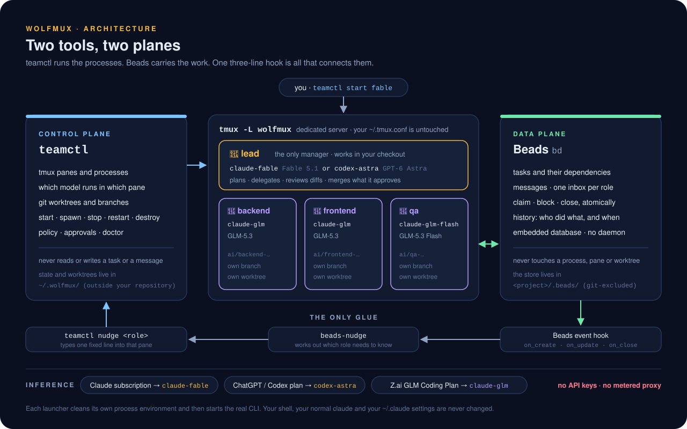
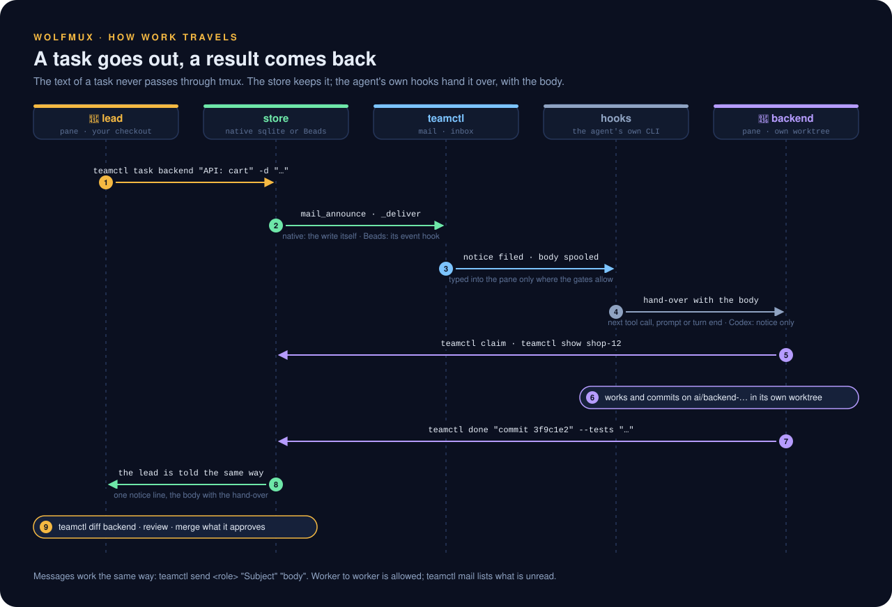
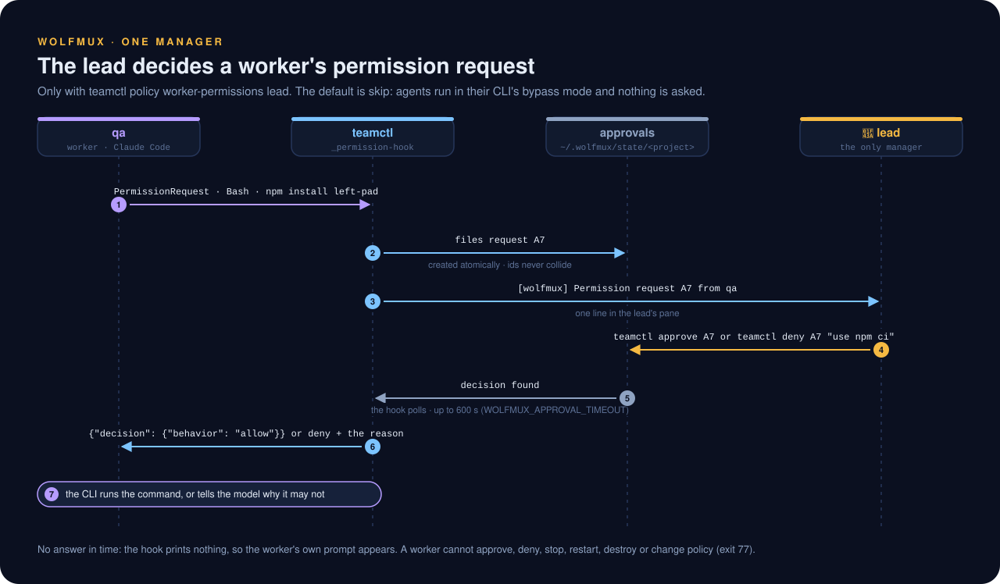
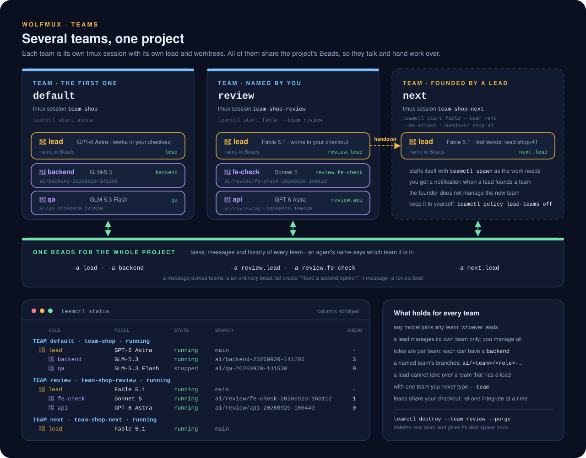
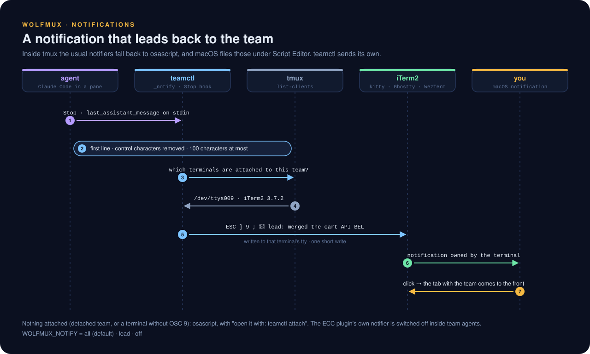

# Architecture

## Two tools, two planes

| Plane | Tool | Owns | Never touches |
|-------|------|------|---------------|
| Control | `teamctl` | tmux panes, which model runs where, git worktrees and branches, start / stop / restart / destroy, diagnostics | tasks, messages |
| Data | `bd` (Beads) | tasks, dependencies, messages, history, who-did-what | processes, panes, worktrees |

The only glue between them is a three-line Beads event hook that calls
`teamctl nudge <role>`. Beads does not know tmux exists; `teamctl` never reads or
writes a bead.



## Components

### Launchers (`~/bin`)

Each launcher cleans **its own process environment** and then `exec`s the real CLI.
The user's shell is never modified. The list of variables to remove lives in one
file, `lib/provider-env.sh`, shared with `teamctl doctor` so scrubbing and
diagnostics can never drift apart.

| Launcher | CLI | Billing | What it pins |
|----------|-----|---------|--------------|
| `claude-fable` | Claude Code | Claude subscription (`/login`) | `--model claude-fable-5-1[1m]`; no key, no endpoint |
| `claude-opus` · `claude-sonnet` · `claude-haiku` | symlinks to `claude-fable` | same | the model named by the link (`claude-opus-5`, `claude-sonnet-5`, `claude-haiku-4-5-…`) |
| `codex-astra` | Codex CLI | ChatGPT / Codex subscription | `forced_login_method="chatgpt"`, `model_provider="openai"`, `model="gpt-6-astra"`. Starts Codex by its **real path**: Codex looks for its helper programs next to the path it was started as |
| `claude-glm` | Claude Code | the provider named by the link: a plan (Z.ai, Kimi, MiniMax, Qwen) or a metered API (Moonshot platform, DeepSeek: refused until `WOLFMUX_METERED=on`) | endpoint, key, model ids and context window from one table (`lib/providers.sh`); every model alias → that provider's main id, background tier → its fast id; a declared window so Claude Code prints no unknown-model notice |
| `claude-glm-flash`, `claude-kimi`, `claude-moonshot`, `claude-deepseek`, `claude-minimax`, `claude-qwen` | symlinks to `claude-glm` | same | the link name picks the provider; `-flash` picks GLM's fast tier |

Scrubbed in every Claude launcher: all `ANTHROPIC_*` and `CLAUDE_CODE_USE_*`
variables (explicit list plus a prefix sweep for future ones), model and subagent
overrides, and the session variables Claude Code sets in its own subprocesses
(`CLAUDECODE`, `CLAUDE_CODE_CHILD_SESSION`, …) — otherwise a CLI started from an
agent's shell believes it is a child session and stops persisting transcripts.
Scrubbed in `codex-astra`: all `OPENAI_*`, `CODEX_API_KEY`, `CODEX_ACCESS_TOKEN`.

`WOLFMUX_DRY_RUN=1 <launcher>` prints exactly what would be executed, without
secrets and without starting anything.

Persistent launcher settings come from `~/.config/wolfmux/config` (parsed as
`KEY=value`, never sourced). A file is needed because a pane's environment comes
from the tmux server, not from the shell that ran `teamctl spawn`.

### teamctl (`~/bin/teamctl` + `~/.config/wolfmux/lib/`)

About 2,200 lines of bash in small modules, written for macOS `/bin/bash` 3.2
under `set -euo pipefail`, depending only on `tmux`, `git` and `jq`.

| Module | Responsibility |
|--------|----------------|
| `provider-env.sh` | the scrub lists, binary resolution, the login guard (every provider), config parsing |
| `providers.sh` | the provider table: vendor, label, endpoint, Keychain service, billing, default model ids, context window, auth variable, key URL per provider |
| `common.sh` | output, validation, tool lookup, **the model table**, project resolution |
| `registry.sh` | the only module that touches state files; project lock; nudge debounce and deferred notices |
| `tmuxctl.sh` | every tmux call, including "is a human typing in this pane" |
| `worktree.sh` | worktree and branch creation, `worktrees`, `diff` |
| `disk.sh` | the build-output allowlist and its safety rules, `prune`, free-disk reading, the spawn guard, shared `node_modules` |
| `beads.sh` | Beads bootstrap (stealth init) and hook installation |
| `policy.sh` | who is calling (`caller_role`), manager-only commands, the policy keys |
| `approvals.sh` | the lead decides workers' permission requests (`_permission-hook`, `approvals`, `approve`, `deny`) |
| `agents.sh` | `start`, `spawn`, the pane process (`_run-agent`), `stop`, `restart`, `destroy`, `nudge` |
| `views.sh` | `status`, `panes`, `capture`, `log`, `focus`, `attach` |
| `doctor.sh` | `teamctl doctor` |

The **model table** in `common.sh` is the single place that knows which launcher
serves which model key (`fable`, `astra`, `glm53`, `flash`) and which CLI family it
belongs to. Nothing else in the code is model-specific, which is what makes the
two leads interchangeable.

Beside it, the **provider table** in `lib/providers.sh` is the single place that knows a
provider: vendor, endpoint, Keychain service, billing (`plan` or `metered`), default model
ids, context window, auth variable, key URL. The model table, `teamctl`, `doctor`, the
dry run and this documentation read it instead of carrying their own copies, which is
what keeps a vendor change a one-row fix.

### tmux

Teams run on a **dedicated tmux server** (`tmux -L wolfmux`) started with its own
config file (`~/.config/wolfmux/tmux.conf`). The user's default tmux server and any
`~/.tmux.conf` are untouched; the team config sources the user's config first if one
exists. It adds mouse support, 100k lines of scrollback, role titles on pane
borders, `remain-on-exit` (a crashed agent keeps its pane and its error), and
current-directory inheritance for new panes. One extra key: `prefix T` re-tiles.

- The server is started with a scrubbed environment, so panes never inherit
  provider or agent-session variables from whoever started it.
- A pane runs the agent **directly** (`tmux split-window … teamctl _run-agent <root>
  <role>`, passed as separate arguments, so there is no `sh -c` and no quoting
  layer). `_run-agent` exports the role, changes into the worktree, builds the
  protocol prompt and `exec`s the launcher, so the pane's process *is* the agent.
- Panes are found by a pane option, `@ai_role`, not by index or title. tmux is the
  source of truth for "is this agent alive" (`pane_dead`, `pane_dead_status`).
- New panes are split off the last pane, then the window is re-tiled, which keeps
  spawn order: lead top-left, then workers left-to-right, top-to-bottom.

### Git worktrees

`teamctl spawn <role> <model>` creates a branch named by the team's branch template
(by default `ai/<role>-<timestamp>`, `ai/<team>/<role>-<timestamp>`; `teamctl policy
branch-template`, `--branch`, `--ticket`) from the
lead's current `HEAD` (or `--base <ref>`) in a worktree at
`~/.wolfmux/worktrees/<project>-<hash>/<role>-<timestamp>/` — outside the
repository, so nothing is nested in the project. Git itself refuses to check one
branch out twice, and `teamctl` refuses a duplicate role, so two agents can never
share a working tree. Claude Code keys folder trust on the main checkout, so
trusting the project once covers every worker worktree.

**What a worktree grows, and who takes it back.** `.git` is shared, so a worktree starts
as a copy of the tracked files, but whatever the agent installs and builds inside it is
its own: on one project here 2.3 GB of `node_modules`, 0.9 GB of `.next` and half a
gigabyte of copied assets per lane. Nothing used to remove it, 27 parked lanes of one
project reached 65 GB, and the machine filled its disk. `lib/disk.sh` is the one module
that deletes any of it: one allowlist of regenerable directory names, and four rules —
only a name on the list, never a path git tracks, never a worktree holding uncommitted or
untracked work of its own, and only inside the worktree directory of that lane's own
repository (`worker_trees_dir`, so a lane spawned with `--repo` is checked against that
repository and not this project) with every path resolved by `pwd -P`. `stop` takes the
build caches, `remove` and
`destroy --worktrees` take everything, `prune` sweeps the parked lanes, `spawn` refuses
under `disk-min-gb`, and each directory is renamed inside its worktree before deletion so
an interrupted cleanup leaves recognizable trash rather than a half-deleted
`node_modules`. `teamctl status` never measures (a `du` over 36 lanes here costs 12.4 s):
the commands that change the lanes leave the number in `~/.wolfmux/state/<project>/disk-kb`
and status reads it.

### Beads

Initialized per project in **stealth, embedded** mode:
`bd init --stealth --skip-hooks --skip-agents --non-interactive --prefix <name>`.
That makes no commit, adds no tracked file (it uses `.git/info/exclude`), installs
no git hooks and edits no AGENTS.md. Embedded means Dolt runs inside each `bd`
process; there is no server. Linked worktrees find the main checkout's `.beads/`
through git's common directory, so every agent shares one database with no
configuration.

Conventions (the full set is in `TEAM_PROTOCOL.md`):

| Need | Beads primitive |
|------|-----------------|
| task | `bd create "Title" -t task -a <role>`; claim with `bd update <id> --claim` (atomic) |
| dependency | `bd dep add <task> <blocker>` |
| message | a bead of type `message`; assignee = recipient, open = unread, `bd close <id> -r read` = read |
| thread | `--deps replies-to:<id>`, shown with `bd show <id> --thread` |
| inbox | `bd list --assignee <role> --status open,in_progress,blocked --include-infra` (without `--include-infra`, message beads are hidden) |
| identity | `BEADS_ACTOR=<role>`, exported into every pane |

## Flows

### Spawning a worker

1. validate role and model key (a metered model is refused while `WOLFMUX_METERED` is off); take the project lock (`mkdir`, released on exit)
2. `git worktree add -b <branch from the template> <path> <base>`, in the project or,
   with `--repo <path>`, in that repository (its own worktrees directory and its own base)
3. write the registry record (role, model, launcher, worktree, branch, base)
4. split a pane that runs `teamctl _run-agent <root> <role>`; tag it with `@ai_role`
5. re-tile; record the pane id. If the pane cannot be created, the fresh worktree,
   branch and record are rolled back.

### A message from lead to worker



1. lead: `bd create "Subject" -t message -a backend -d "…"` — durable, atomic, in Beads
2. Beads fires `.beads/hooks/on_create` with the bead as JSON on stdin
3. `beads-nudge` sees an assignee that is not the actor and calls
   `teamctl nudge backend --quiet --id <bead-id>` in the background
4. `teamctl` validates role and id, debounces bursts (3 s, under a per-role guard),
   checks that nobody is typing in that pane, and types **one fixed line** into it:
   `[wolfmux] Beads update for backend (<id>). Run: bd show <id> -- then: bd list …`
5. the worker runs the command it was shown and reads the body from Beads

### Never into a half-typed line

A pane is a keyboard somebody may be using. Typing a notice into it mid-sentence
submitted the human's unfinished text and the notice together as one message, which
is what GitHub issue #9 reported.

**Why type at all, rather than use the status line or a popup?** Because the notice is
for the AGENT in that pane, not for the human. The agent reads it as input and runs the
inbox command it names. `display-message` and `display-popup` put text in front of a
human only, so an agent would never see it, and the lead's pane — the one a human sits
at, which is exactly where issue #9 happens — would stop being notified at all. Typing
is the only channel that reaches the agent, so detect-and-defer is the shape the channel
forces. Do not "simplify" it into a popup.

Before anything is typed, `tm_pane_human_busy` asks three cheap questions, and any yes
means busy:

| Check | How | Needs a client attached? |
|-------|-----|--------------------------|
| the pane is in copy mode or scrollback | `#{pane_in_mode}` is 1, so keys would drive the mode, not the prompt | no |
| somebody is at this pane and pressed a key moments ago | it is the active pane of the active window of an attached session, and that client's `#{client_activity}` is less than `WOLFMUX_NUDGE_HUMAN_IDLE` (5 s) old. tmux moves `client_activity` on real keystrokes only: not on pane output, not on `send-keys` from outside, and a detached session lists no client at all | yes, by construction |
| the input line already holds something | the row at `#{cursor_y}`, captured with `-e`, with escape sequences and DIM runs removed, then box glyphs, non-breaking spaces, whitespace and ONE leading prompt marker removed, is not empty | no |

**Only the keystroke check needs a client**, and it needs one by construction: the sole
evidence that a key was pressed is an attached client's `#{client_activity}`. The
input-line check runs whether or not anybody is attached.

It used to need a client too, on the reasoning that with nobody attached nobody can be
typing. That is false, and it reopened issue #9: type a line, do not submit it, then
detach — or just walk away from `teamctl attach --team X` — and the notice was typed over
the half-typed line and submitted with it. Review round 2 reproduced exactly the reported
symptom on a detached session.

What separates a TUI's own furniture from somebody's typing is **dim**, not the client
list. Measured 2026-10-09 against a real Claude Code in a throwaway tmux socket, nothing
submitted:

| the input box | the row as `capture-pane -e` hands it over | read as |
|---------------|--------------------------------------------|---------|
| empty | `❯<NBSP> ESC[2m Try "fix typecheck errors"` | clean — the placeholder IS dim |
| typed into | `❯<NBSP> i said install bun if requir` | **dirty** — no escape sequences at all |

So the dim strip cannot eat text a human typed, and dropping the client gate cannot bring
back the regression it was there for (an idle agent whose hint made it read busy for as
long as the hint showed, so every nudge waited out the expiry and was dropped). The price
is the other direction: a placeholder drawn in a plain colour rather than dim now reads as
typing on a **detached** pane as well as an attached one, and that agent's notices wait out
the cap and are dropped. Nobody has seen such a placeholder — every Claude Code one
measured, live and in the probe, was `ESC[2m` — and Codex is unmeasured.
`WOLFMUX_NUDGE_COLLISION_CHECK=0` is the way out. [ROADMAP](ROADMAP.md) carries it as a
known limit.

Everything from the point where the row is looked at **fails closed**: a capture that
fails, a cursor row that makes no sense, and a client list that cannot be read all count
as busy. The one exception is the first `display-message`: when that fails there is no
session and no pane to fail closed for. A false busy only delays, and every delay is
bounded by the expiry.

Busy means the notice is **parked, not dropped**: a per-role marker under
`~/.wolfmux/state/<project>/nudge/<role>.pending` holds it and ONE detached waiter per
role looks again every `WOLFMUX_NUDGE_RETRY` (3 s, floored at 1) for up to the marker's
cap — `WOLFMUX_NUDGE_DEFER_MAX` (600 s), or `WOLFMUX_NUDGE_APPROVAL_DEFER_MAX` (60 s) for
an approval notice, which is worthless once the worker has stopped waiting for the
decision. It looks once BEFORE its first sleep, so an already-idle pane is notified at
once. Beads nudges that pile up while it waits **collapse into one line** (two different
bead ids, or an empty id beside a real one, give the generic line, which names the whole
inbox anyway); spawn, approval and policy notices each name their own event, so they
queue instead, and the pane is asked again before EVERY queued line, each line leaving
the marker as it is typed so a stop part-way can never re-send what already went out.
On expiry the marker is removed and `nudge-defer-expired` goes into `events.jsonl`.

The per-role lock is never held across the wait. A marker whose waiter died is **reaped**
by the next notice for that role (`nudge_pending_reap`, under the lock): without that it
would swallow every later notice for ever. The waiter itself ignores `HUP`, `INT` and
`TERM` — macOS has no `setsid(1)` — so closing the terminal that ran `teamctl` does not
kill it. `teamctl nudge` says `deferred: …`, names the check that fired, and exits 3.
`WOLFMUX_NUDGE_COLLISION_CHECK=0` brings the old blind typing back.

One window stays open: `tm_type_line` sends the text, waits 300 ms so a TUI does not read
the Enter as part of a paste, then sends Enter. A human who had been idle for
`WOLFMUX_NUDGE_HUMAN_IDLE` seconds can start typing inside those 300 ms and have their
first keystrokes land after the notice. Closing it needs tmux to report a key arriving
mid-line, and there is no such channel. Measured with a watcher typing from the moment a
notice appears, re-checking between queued lines cut the glued lines from 5 of 5 to 2 of
5 and kept the other 3 for later.

**What that number does and does not bound.** The watcher types with `tmux send-keys`,
which does not move `#{client_activity}`, so the keystroke check can never fire for it:
the figures bound the input-line check alone. A real person at a real keyboard also trips
the keystroke check, so they are protected by more than this, and a review round-2 run
with a much more aggressive send-keys watcher glued 6 of 6 — same reason. An honest
measurement needs keystrokes pushed through an attached client's own stdin; that harness
does not exist yet (one attempt deadlocked) and is a named follow-up. What both runs did
confirm, which is what matters for correctness, is that no notice was ever delivered twice
and none was lost.

The message body never travels through tmux, so there is nothing to quote, escape
or truncate. The same hook tells the lead when a worker closes a task or marks
one blocked. Comments fire no hook, by Beads' design.

### Completion

Worker tests → commits on its branch → sends `Done: …` to the lead (summary, test
status, commit hash, risks) → closes its task. Lead runs `teamctl diff <role>`,
reviews, then requests changes, cherry-picks, rejects, or asks another worker to
review. Only the lead changes the main checkout.

## One manager

The lead is the only manager. Three mechanisms keep it that way:

1. **Manager-only commands.** `caller_role` reads the `@ai_role` of the pane a command
   runs in (falling back to `TEAM_ROLE`; empty means the human). `start`, `stop`,
   `restart`, `destroy`, `policy`, `approve` and `deny` require the lead or the human;
   `spawn` does too unless the `worker-spawn` policy is `on`.
2. **No native teams inside workers.** `_run-agent` writes a per-agent settings file; for a worker it holds
   `env.CLAUDE_CODE_EXPERIMENTAL_AGENT_TEAMS = "0"` and `teammateMode = "in-process"`. teamctl
   hands the file to the launcher through `WOLFMUX_EXTRA_SETTINGS`; the launcher merges it
   into its single `--settings` value. With Claude Code's agent-teams feature on, any
   subagent a session names becomes a teammate whose team lead — and permission
   approver — is that session, so a worker would become a second manager.
3. **Awareness.** A spawn by a worker records `spawned_by`, shows in `teamctl status`,
   and types `[wolfmux] Team change: <spawner> spawned teammate <role> (<model>)` into
   the lead's pane. Policy changes made from outside are announced the same way.

4. **Lanes.** A worker's generated settings carry a `PreToolUse` hook, `teamctl _guard`
   (`lib/guard.sh`). It knows the worker's worktree and branch from the environment
   `_run-agent` exports (`WOLFMUX_WORKTREE`, `WOLFMUX_BRANCH`, `WOLFMUX_ROOT`) and
   answers `deny` with a reason for tool calls that leave the lane. File tools are
   resolved to real paths; shell commands are matched after every spelling of the known
   directories has been replaced by a token. See [ADR-0016](adr/0016-worktree-guard.md).

### Permission modes

| Mode | Claude Code | Codex |
|------|-------------|-------|
| `skip` | `--dangerously-skip-permissions` | `--dangerously-bypass-approvals-and-sandbox` |
| `lead` (workers) | a `PermissionRequest` hook → `teamctl _permission-hook` | not available; behaves as `ask` |
| `ask` | the CLI's own prompts | the CLI's own approvals and sandbox |

In `lead` mode the hook files `approvals/A<n>.json` (tool, a 400-character summary of
the input, role, time), types `[wolfmux] Permission request A<n> from <role>` into the
lead's pane, and polls for up to `WOLFMUX_APPROVAL_TIMEOUT` seconds. `teamctl approve`
/ `deny` flip the record; the hook returns Claude Code's documented decision object
(`behavior: allow` or `deny` with the lead's reason). On timeout, or when no lead pane
is alive, it returns nothing, which means "show the normal prompt".



## Teams

A project has one or more teams ([ADR-0018](adr/0018-several-teams-per-project.md)).
`load_project` resolves the repository, then the team: `--team`, else the caller's own
(`@wolfmux_team` on the tmux session, `WOLFMUX_TEAM` in the agent's environment), else the
only one there is. Everything per team hangs off two variables it sets, `STATE_DIR` and
`WORKTREES_DIR`, which is why policy, approvals, arrangement, guard and notifications
needed no team logic of their own.

| | first team (`default`) | named team |
|---|---|---|
| tmux session | `team-<project>` | `team-<project>-<team>` |
| state | `~/.wolfmux/state/<project>/` | `…/<project>/teams/<team>/` |
| worktrees | `~/.wolfmux/worktrees/<project>/<role>-<stamp>` | `…/<project>/teams/<team>/<role>-<stamp>` |
| branches | `ai/<role>-<stamp>` | `ai/<team>/<role>-<stamp>` |   (the default template; `teamctl policy branch-template` sets another)
| Beads name | `<role>` | `<team>.<role>` |

The Beads hook reads the team out of the assignee's name (`review.backend`) and the lead to
tell out of the actor's (`review.lead`); `teamctl nudge` accepts the same names. For an agent
of a named team the protocol's examples are rewritten at launch (`-a lead` → `-a review.lead`).



Founding and deleting ([ADR-0019](adr/0019-deleting-a-team-and-founding-one.md)). `teamctl
start` is yours and, for its own team, the lead's. One thing more: a lead may start a team
that does not exist yet (`start_permitted`; policy `lead-teams` of the founder's team,
default on), and `--handover <bead-id>` is stored in the new lead's record and becomes its
first prompt. The founder is
recorded as `spawned_by`, you are notified, and the founder does not manage the new team
while that team's lead runs. When it does not (`team_lead_running` asks tmux: no session,
a dead pane or none), `require_manager` and `start_permitted` let the founder run `restart`,
`stop`, `remove`, `destroy` and `start --continue` on it, announce each one to you and log it
with the founder's Beads name ([ADR-0023](adr/0023-founder-recovers-an-orphaned-team.md)).
`teamctl destroy --purge` is the reverse: `_purge_report` measures and lists first (size per
worktree, uncommitted files, commits the checked-out branch does not have, transcripts).
Nothing is touched until the answer is yes, `--force` was given, or `--yes` with nothing at
risk. `_purge_team` then ends the session and removes the team's own state files; a
worktree named in a record only when it lies inside the team's worktree directory (with
the transcript folder derived from its path); a branch only when teamctl created it
(`branch_created` in the record; a record from before that field counts its `ai/…` branch as
teamctl's) and it is not the
one checked out in your checkout.

What teams do not have apart: your checkout. Every lead works in the project root.

## Arrangement and coming back

`lib/layout.sh`: `lead-left` (default: the lead is tmux's main pane at 55 % of the width,
workers stacked on the right), `lead-top`, `tiled`. Applied after every start, spawn, stop
and restart; the lead is first moved to the first pane, because a re-created lead pane
would otherwise not be tmux's "main" one. Stored per project in `meta.json`.

`remain-on-exit` keeps a finished agent's pane, so a session can outlive every process in
it. `teamctl start` therefore looks at what is alive: lead alive → attach; lead gone but a
worker alive → the lead is restarted in place; nothing alive → the session is killed,
worker records become `stopped` (worktrees and branches stay), and a new session starts —
on the new socket if that was the last session of a pre-rename server.

## Notifications

Every Claude-based agent gets a `Stop` hook, `teamctl _notify`, through its generated
settings file. It takes the first line of the agent's last message, strips control
characters, and writes an OSC 9 notification to the tty of each terminal attached to
the team (`tmux list-clients`, terminals known to support it: iTerm2, kitty, Ghostty,
WezTerm). The notification therefore belongs to the terminal, and clicking it brings
the tab with the team to the front. The usual notifiers cannot do that from inside
tmux: they fall back to `osascript`, whose notifications macOS files under Script
Editor. With nothing attached — a team left to work in the background — the message is
posted by `~/.config/wolfmux/Wolfmux.app`, a small application `install.sh` builds with
`osacompile`. macOS opens the owner of a notification when you click it; Wolfmux.app,
started with no message waiting, takes that as the click and runs `teamctl _open-team`,
which opens a terminal window attached to the team. The ECC plugin's own notifier is switched off inside team agents
(`ECC_DISABLED_HOOKS`, merged with whatever you already disable) so you get one
notification, not two. `WOLFMUX_NOTIFY=all|lead|off`. See
[ADR-0015](adr/0015-notifications-through-the-attached-terminal.md).



## The wolf

Cosmetic, and built so it can never fail a command (`lib/brand.sh`):

| Where | What |
|-------|------|
| opening a team (`teamctl start`, `teamctl attach`, plain `tmux attach`) | a popup with the wolf, the wordmark and a line about the team; a `client-attached` hook set per session. Any key closes it, or 3 seconds. `WOLFMUX_SPLASH=off` removes it |
| the manager's pane | `🐺 lead · <model>` in the border title and an amber border, focused or not; the pane opens with the wolf; a Claude lead is named `🐺 team/lead` inside Claude Code |
| every teammate's pane | `🐶 <role> · <model>` in the border title, `🐶 team/<role>` inside Claude Code, `🐶 <role>: …` in notifications |
| status line and terminal tab | `🐺 WOLFMUX` on the left of the status line; the tab title is `🐺 <session>` |
| `teamctl status` | `manager: 🐺 lead` |

One pixel drawing (`tools/wolf-art.py`) produces the terminal art in `lib/brand.sh`,
`docs/diagrams/wolf.svg` and the wolf inside the hero image.

## State and file layout

```
~/bin/                          teamctl + launchers
~/.config/wolfmux/              code, tmux.conf, TEAM_PROTOCOL.md, README.md, config, glm-worker-settings.json
~/.wolfmux/state/<project>/     meta.json (incl. policy), agents/<role>.json, settings/<role>.json, approvals/, events.jsonl, nudge/ (debounce stamps, <role>.lock, <role>.pending), disk-kb
~/.wolfmux/worktrees/<project>/ one directory per worker
<project>/.beads/               tasks and messages (Beads)
macOS Keychain                  one service per provider: "zai-coding-plan" (Z.ai),
                                "wolfmux-kimi", "wolfmux-moonshot", "wolfmux-deepseek",
                                "wolfmux-minimax", "wolfmux-qwen"
```

`<project>` is `<directory-name>-<6 hex of the path hash>`. Nothing of `teamctl`'s
is written inside the repository. The registry holds process and worktree facts
only and is reached exclusively through `reg_*` functions, so the JSON files could
be replaced by another store without touching a command.

## How agents learn the rules

`_run-agent` builds a prompt from a short header (role, kind, model, worktree,
branch, base) plus `TEAM_PROTOCOL.md` and injects it at launch:
`--append-system-prompt` for Claude Code, `-c developer_instructions='''…'''` for
Codex. No CLAUDE.md or AGENTS.md is edited, and only team sessions see the
protocol. Workers also get a one-sentence kickoff prompt telling them to read
their inbox (`--no-kickoff` skips it); the lead gets none, because the human
drives it.
