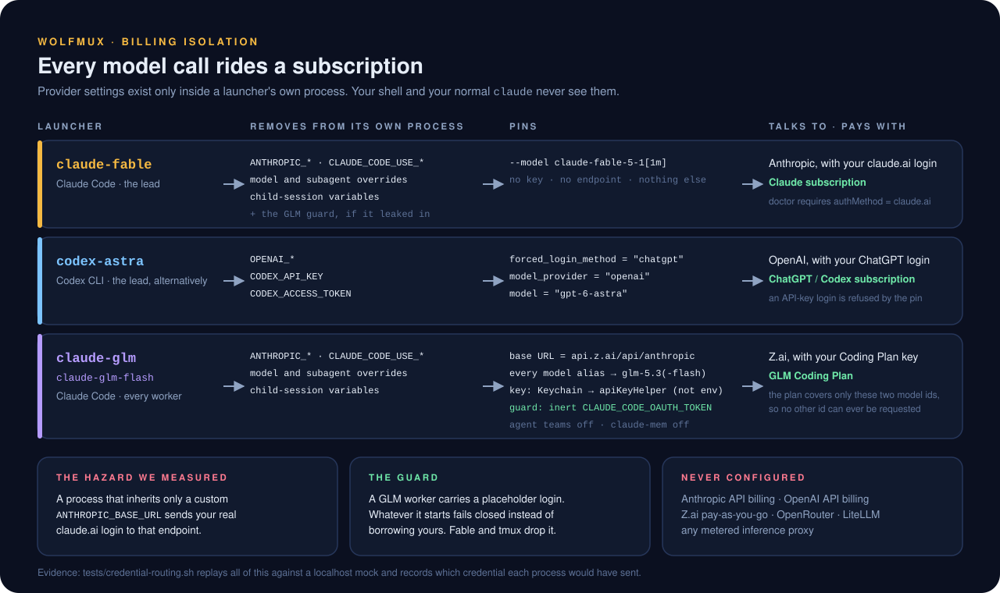

# Billing isolation and security model

The non-negotiable requirement is that every model call is paid for deliberately:
the three subscriptions by default, a metered provider (the Moonshot platform,
DeepSeek) only after you, the owner, set `WOLFMUX_METERED=on` yourself. This page
states what enforces that, what was measured, and what cannot be proven from the
machine.

## The three rules

1. **Nothing global.** No provider variable in a shell profile, no provider entry in
   `~/.claude/settings.json`. `teamctl doctor` checks both and fails loudly. Plain
   `claude` therefore behaves exactly as it did before this was installed.
2. **Every launcher scrubs, then execs.** Whatever environment a launcher inherits
   — your shell, an agent's shell, a tmux server — it removes every variable that can
   redirect, re-authenticate or re-bill the CLI before starting it. The list is one
   file (`lib/provider-env.sh`): explicit names plus prefix sweeps (`ANTHROPIC_`,
   `CLAUDE_CODE_USE_`, `OPENAI_`) so a variable added by a future CLI release is
   still removed.
3. **Provider configuration lives only inside the process that needs it.** Each
   provider's endpoint and model mapping are exported inside `claude-glm`, under
   the provider name it was started as, and nowhere else.

## Per launcher

| Launcher | Credential that remains | Enforcement |
|----------|-------------------------|-------------|
| `claude-fable` | the claude.ai `/login` | nothing else survives the scrub. `teamctl doctor` asks Claude Code itself: `claude-fable auth status --json` must report `authMethod: claude.ai` |
| `codex-astra` | the ChatGPT login | `-c forced_login_method="chatgpt"` makes Codex refuse API-key auth even if a key is stored later; `-c model_provider="openai"` neutralises a redirected provider in `config.toml` |
| `claude-glm` (any provider name) | that provider's key | the endpoint comes from one table (`lib/providers.sh`) and is pinned per provider (Z.ai: the Coding Plan endpoint, not Z.ai's general API); **every** alias Claude Code can resolve (opus, sonnet, fable, haiku, subagents, the main model) is mapped to that provider's main and background ids, so only ids the plan or account covers can be requested |

## How the Z.ai key reaches a worker

The key is read from the macOS Keychain (service `zai-coding-plan`), never from a
file or a profile.

Every provider works the same way with its own Keychain service (`wolfmux-kimi`,
`wolfmux-moonshot`, `wolfmux-deepseek`, `wolfmux-minimax`, `wolfmux-qwen`) and its
own knob (`WOLFMUX_
_AUTH_MODE`); Z.ai is the example here. Kimi's `env` mode
exports `ANTHROPIC_API_KEY`, which its documentation asks for; the others export
`ANTHROPIC_AUTH_TOKEN`.

- **`helper` (default).** The launcher passes
  `--settings '{"apiKeyHelper": "/usr/bin/security find-generic-password -s zai-coding-plan -w"}'`.
  Claude Code runs that command when it needs the key. The key is never in the
  environment, so nothing the agent spawns can see it, and it cannot end up in a
  transcript or in tmux scrollback through an `env` dump. Only the command line —
  which contains no secret — is visible in `ps`.
- **`env` (fallback).** `WOLFMUX_GLM_AUTH_MODE=env` in `~/.config/wolfmux/config`
  exports `ANTHROPIC_AUTH_TOKEN`, which is Z.ai's documented method. Use it if the
  endpoint ever rejects helper mode (Claude Code sends a helper's value as both
  `x-api-key` and `Authorization: Bearer`). The trade-off: the key is then visible
  to the worker's subprocesses. It is a last resort: it cannot fix a wrong key, and for
  Kimi's `ANTHROPIC_API_KEY` Claude Code asks interactively before using it, with no
  documented setting that pre-approves the key.

### The login guard — found by measurement

Claude Code's documented credential precedence is: cloud-provider credentials →
`ANTHROPIC_AUTH_TOKEN` → `ANTHROPIC_API_KEY` → `apiKeyHelper` →
`CLAUDE_CODE_OAUTH_TOKEN` → profile credentials → the `/login` subscription.

`tests/credential-routing.sh` points Claude Code at a localhost mock that records
only the *kind* of credential received and rejects every request. Results:

| Scenario | `Authorization` received | Model id |
|----------|--------------------------|----------|
| helper mode + guard (the default launch) | the Z.ai key | `glm-5.3` |
| env mode + guard | the Z.ai key | `glm-5.3` |
| **only `ANTHROPIC_BASE_URL` inherited** (no token, no helper) | **the real claude.ai login** | `glm-5.3` |
| the same, with the guard | an inert placeholder | `glm-5.3` |

Row three is the hazard: a process that inherits the Z.ai base URL without a
credential falls through to the stored login and would present the Claude
subscription token to a third party. A helper passed by command-line flag is
exactly such a case for anything the worker spawns (a nested `claude -p`, an
agent-teams teammate, a background session).

So every provider worker exports `CLAUDE_CODE_OAUTH_TOKEN` set to a non-secret
placeholder. It ranks above the stored login and below both real delivery modes:
the worker itself still authenticates with the Z.ai key (rows one and two), while
anything it spawns fails closed with a 401. `claude-fable` removes the placeholder
again, and a genuine `CLAUDE_CODE_OAUTH_TOKEN` of yours is left alone.

## GLM worker settings overlay

`~/.config/wolfmux/glm-worker-settings.json` is merged into third-party provider workers' settings
only. It ships with the `claude-mem` plugin disabled there: that plugin runs a
long-lived summarizer that inherits the environment of whichever session starts
it, and one started from a provider worker would route memory traffic from your normal
Claude sessions to that provider. Delete the file to make workers identical to your normal
sessions. The general rule: a plugin that spawns a persistent process from a
worker inherits the worker's provider.

## What `teamctl doctor` checks

Launchers present and executable · provider variables inherited by the current
shell (names only) · `env` overrides and `apiKeyHelper` in the user and project
Claude settings — these apply *inside* Claude Code and would defeat the scrub, so
they are reported loudly · provider exports in shell profiles · which credential
`claude-fable` would really use · `codex login status` and whether `auth.json`
stores an API key · the Keychain items (existence only, one service per provider: a missing key is a RISK for Z.ai, the default worker, and a NOTE ("optional, not set up") for the others) · every provider's hostname and endpoint string grepped anywhere
outside the launchers · key delivery mode, guard and overlay · `CLAUDE_CONFIG_DIR`
/ `CODEX_HOME` relocations · Beads install, telemetry state and hooks.

It prints names and paths, never values. Exit `0` clean, `2` billing/routing
warnings, `1` a missing requirement.

`teamctl doctor --probe` is the one mode that reads a key value, and only for the providers whose
Keychain item exists. It sends one incomplete request per provider (`POST /v1/messages`, body
`{}`, so nothing is generated or billed) to the endpoint in the provider table, only over https,
and prints only the HTTP status. The value is read in one function, handed to curl on its stdin
(a pipe from a shell builtin: not an argument, not an environment variable, not a file), never
printed, and refused if it has a character that could add a line to curl's config. curl reads no
`~/.curlrc` and follows no redirect. It cannot send a key anywhere but the table's endpoint: the
table has no setting for the address ([ADR-0024](adr/0024-doctor-probe-and-key-sources.md)).

## What cannot be proven locally

Account-side switches are invisible to any local tool. `doctor` prints them as
reminders rather than pretending:

- **claude.ai → Usage → extra usage**: if on, overage beyond the plan is metered.
- **ChatGPT → Codex usage**: purchased credits are consumed after plan limits.
- **z.ai → Billing**: keep the cash balance at zero. Z.ai's FAQ says calls outside
  the plan's two models or endpoint can draw on a balance.

- **Moonshot platform / DeepSeek, with `WOLFMUX_METERED=on`**: billed per request
  with no local cap. wolfmux has no spending limit a run can hit: a long run costs
  what the vendor's per-request prices make it cost, for as long as the balance you
  loaded lasts. The switch is in your config file; an agent that asks for it should
  be refused.

Wording used throughout: *"Configured for subscription authentication; verify
account status in the CLI."*

## The metered gate

The gate reads the owner's real config file, found through the system's passwd database:
neither `WOLFMUX_METERED` exported into the environment, nor a redirected `HOME` or
`WOLFMUX_HOME`, opens it. Like the worktree guard ([ADR-0016](adr/0016-worktree-guard.md))
it is a guard against accident and casual override, not a sandbox: every agent runs as
your macOS user, so a process that edits `~/.config/wolfmux/config` or a launcher can
open it. The worktree guard refuses a worker's `Edit` and `Write` on that file, but not a shell
command the worker runs, and a lead is not guarded at all.
Two details worth knowing: a pane that refuses at the launcher (exit 78) shows the reason
in its own pane, and `teamctl restart` of a metered agent is gated in the launcher, not
in teamctl.

## Permission modes are a policy, not a sandbox

The default policy runs the lead and the workers in their CLI's bypass mode, because
that is what the owner asked for: no agent stalls on a prompt. In that mode an agent can
run any command as the macOS user. What still applies: Claude Code `deny` rules in every
mode, explicit `ask` rules (the installer adds one for `teamctl destroy`), `teamctl`'s
own confirmation before `destroy`, and the protocol's conduct rules. What limits the
blast radius in practice: each worker sits in its own worktree on its own branch, and
only the lead integrates.

For a stricter team without losing flow: `teamctl policy worker-permissions lead` routes
every worker request to the lead; `ask` hands them back to a human. Both are per
project and take effect on the next (re)start of an agent.

The manager check (`caller_role`) is cooperative. It reads the pane a command runs in,
so a confused agent cannot stop, approve or spawn by accident; an agent that deliberately
unset its environment or called `tmux` directly could get around it, because all agents
share one user account.

## Team memory: who can read a lead's private folder

`teamctl memory enable <team>` (v1.22.0, [ADR-0030](adr/0030-one-lead-keeps-a-private-memory.md)) gives ONE
team's lead `~/.wolfmux/memory/<project>/<team>/`. What keeps it private, and where that ends:

| Layer | What it does | Where it ends |
|-------|--------------|---------------|
| Owner-only switch | only you turn it on (`require_operator`, the pane proof; an agent gets 77). Turning it off only narrows, so that lead may do it too | cooperative, like every identity check here |
| File modes | the folder and its subfolders are 700, files 600, `bin/mem` 700 | every agent is your macOS user: modes stop other accounts, not other agents |
| Who is given it | only that lead's settings carry `autoMemoryDirectory`, and only its prompt names the folder. Only while you founded that team (a team another lead founds under the same name, after a `destroy --purge` or a `finish`, gets nothing) and the folder's `bin/mem` can run (a missing or hand-edited folder gives nothing). No restart, restore or model change moves a team's founder, so `memory enable` refuses a team an agent founded; `teamctl memory adopt <team>` (yours alone, logged, you are told) makes you its founder first | the path itself is no secret: it follows from the project and the team's name |
| No notes in the prompt | the "Team memory" block holds the folder, the rules and the line that runs `mem boot`; the card (`core/card.md`) is printed by `mem boot` inside that lead's own conversation | a prompt is not private: `ps -axww -o command=` shows every agent's whole `--append-system-prompt` to every process of your user, and `teamctl _prompt lead --team <team>` prints it to any caller. That is why the card is not in it |
| Owner-only commands | `teamctl memory check` (it writes: it rebuilds `MEMORY.md` and the card, and prints ask ids and names) and `teamctl memory path` (a path feeds `$(teamctl memory path)`, which the guard cannot read) are yours and that lead's only: anyone else gets 77. `teamctl capture` of that lead's pane (it shows the card after a boot) is yours alone, also after the policy moved (`memory disable`, another team named, a lost x bit on `bin/mem`) for as long as the running lead's settings still carry `autoMemoryDirectory`: it holds the memory until its restart. `teamctl destroy --purge --memory` is yours alone: `require_operator`, the pane proof, decides; the typed team name is a second step, not the protection (a piped `script -q /dev/null` gives a process a terminal) | cooperative, like every identity check here: a process that drops its identity is taken for you (see below the table). Leads are not guarded: another team's lead could run `tmux capture-pane` by hand, and is held only by its protocol |
| The worktree guard (workers) | a worker's Read, Grep, Glob, LS, Edit, Write or MCP call is refused on the folder, and on the folder of the leads' conversations, `~/.claude/projects/<project path>/` (every lead's transcript is a `*.jsonl` file there; its shared `memory/` stays open). So is a Grep or Glob of a folder that holds either one (`~/.wolfmux`, `~/.claude`, your home, `/`); an absolute Glob pattern is judged by the folder it starts in, and a relative one with `..` is resolved against its `path` (or the working folder) first. A Bash command is refused when it names either folder by its full path, also spelled with `~`, `$HOME`, `${HOME}` or `~<name>` (your own name is your home, another is `/Users/<name>`), or when the part the shell would run contains `.wolfmux/memory` (a commit message, a heredoc body or a quoted sentence that mentions it passes; a quoted path does not). Words with `..` or a leading `./` are resolved against the working folder, and after a literal `cd <folder>` or `pushd <folder>` against that folder, before any of these checks, so `cat ../../../../memory/<key>/<team>/core/card.md` from a lane is the folder. The text a shell is handed to run (`bash -c "…"`, `sh -lc '…'`, `zsh -c`, `eval "…"`, `<<<`, a heredoc fed to a shell) is unquoted and checked as a command of its own, three levels deep (deeper is refused), in the start folder and in every folder a `cd` of the command reached. A command of more than 4,000 words, or with more than 100 relative paths, is refused with "split it". A word with `*`, `?` or `[` is refused when the part before the first wildcard is your home or the start of a private folder (`cat ~/.wolfmux/mem*/…`, `grep -r x ~/.*`). A tree walk whose starting folder holds either one is refused with "search a narrower folder": `grep -r`/`-R`, `rg`, `find`, `ls -R`, `du`, `tar` of `~`, `~/.wolfmux`, `~/.claude` or `/` (a grep or rg pattern is not taken for a folder: `grep -rn "/Users/" src/` passes). A command whose working folder is inside a private folder is refused. Paths are compared without regard to letter case (the disk does not tell `~/.WOLFMUX/MEMORY` from `~/.wolfmux/memory`), with `/./` removed anywhere in the line, and a `\` line continuation is joined first | the guard reads TEXT. What still passes: a relative path after a `cd` whose folder is only known at run time (`d=~/.wolfmux; cd $d && cat memory/…`), after a `cd` that `CDPATH` resolves, or after a `cd` to a wildcard (`cd ~/.wolf*`); a path built at run time (`d=.wolf; cat ~/${d}mux/memory/…`); code in another language (`python3 -c "…"`, `perl -e`, `node -e`), even with the full path inside it; a script the command runs (`bash ./x.sh`); tree walkers the guard does not know: `cp -R`, `rsync`, `zip -r`. Off for a team with `worker-isolation off`. Leads are never guarded: another team's lead is held only by its protocol |
| Claude Code's own records (workers) | `~/.claude/file-history/` (pre-edit copies of every file a session changed with Edit or Write, kept per conversation, outside the project), `~/.claude/todos/` and `~/.claude/paste-cache/`, and the same folders under `$CLAUDE_CONFIG_DIR` (as configured and as resolved), are closed to a worker's Read, Grep, Glob, LS, Edit, Write and MCP calls and to Bash commands that name them. A whole-tree search of `~/.claude` is refused because of them, even when the transcripts live elsewhere | the same text guard as the row above, with the same gaps. Other files Claude Code may add under `~/.claude` later are not on the list until someone adds them |
| `teamctl memory status` | open to anyone: the policy, sizes, counts, the index against its cap, the lead's state. The folder's path and the lead's conversation id (an id is what `claude --resume` opens) are printed only to you and that lead; anyone else, a caller that fails the pane proof included, gets the same lines without them | a narrowing, not a secret: the path follows from the project and the team's name, and `teamctl status --json --team <team>` still lists every agent's conversation id to any caller (the records under `~/.wolfmux/state` hold it too; the guard closes those to workers, not to leads). What keeps another session out of that conversation is the transcripts rule above and the `--continue` refusal below, not the id being unknown |
| The rule in the prompt | nothing from the folder goes into Beads, Jira, Slack, repositories or reports; reports carry structure and counts | conduct, not enforcement |
| `--continue` | while team memory is on, refused for EVERY lead of the project that has no stored conversation id: `claude --continue` opens the newest conversation in the folder all leads share, so the memory lead could get another lead's conversation and any other lead the memory lead's, card and all. `start`, `restart` and the pane's own `_run-agent` all refuse it, naming the memory team. With the policy off, nothing is refused (the old newest-transcript guess) | a human running `claude --continue` by hand in the project is not stopped, and a Codex lead resumes with `codex resume --last` whatever is said here (`memory status` warns about a Codex memory lead) |

**Every owner-only gate here is a pane proof, and a process can drop it.** `memory enable`, `memory
adopt`, `memory check`, `memory path`, `capture` of the memory lead's pane and `destroy --purge
--memory` all ask who the caller is (`caller_resolve`), and a caller that claims no identity at all (no
`TEAM_ROLE`, no `TMUX_PANE`) is you. An agent that unsets both, as in `env -u TMUX_PANE -u TEAM_ROLE
teamctl capture lead --team <team>`, is taken for you. The worker guard refuses the obvious forms in a
worker's Bash text: `env -u` / `--unset` of `TEAM_ROLE`, `TMUX_PANE`, `WOLFMUX_TEAM` or `BEADS_ACTOR`,
`unset` and `export -n` of them, an assignment to one of them (alone, exported, or as a `X=… command`
prefix), `env -i`, `env -`, `env --ignore-environment` and `exec -c`. It does not see a script that does
the same (`bash ./x.sh` with an `unset` inside), code in another language (`python3 -c "import os; …"`),
or a command handed to a fresh shell outside the pane (`osascript` telling Terminal to run it). Leads
are not guarded at all: any lead can drop its identity and act as you. These gates hold back an agent
that follows its protocol and catch slips; they do not stop an agent set on getting in.

`teamctl memory status` may be run by anyone: it prints sizes, counts and the policy, never what a note
says, and the path and conversation id only to you and that lead. Nothing deletes the folder except `teamctl destroy --purge --memory` (yours alone, see above) and
`uninstall.sh --purge --purge-memory` (both words: `--purge-memory` alone removes nothing and exits 64);
`install.sh` never touches it. `uninstall.sh` is a script you run by hand, and it checks no identity:
whoever runs it with both words deletes every memory folder, as they could with `rm -rf`.

## Trust model

Every agent runs as your macOS user. That has consequences worth stating plainly:

- Any agent can run `security find-generic-password -s <service> -w` for any
  provider's service. The Keychain protects the keys from files, history and other
  users, not from processes you launch yourself. A plan key's blast radius is that
  plan's quota; a metered key's is the balance loaded on it, which is what
  `WOLFMUX_METERED` gates and why setting it is yours alone.
- `teamctl nudge` validates the role and bead id (letters, digits, `-`, and `._` for
  ids; alphabets spelled out, because `[a-z]` follows the locale) and types only a fixed
  template, so bead content cannot inject keystrokes through it.
- **Teammates are kept apart by a guard, not by a wall.** Each worker has its own
  worktree and branch, and a `PreToolUse` hook (`teamctl _guard`,
  [ADR-0016](adr/0016-worktree-guard.md)) refuses tool calls that change files outside
  that worktree, read a teammate's worktree or teamctl's state, write into the lead's
  checkout, switch, move or delete branches, touch `git worktree`, push to main, or run
  `tmux`. File tools are checked exactly; shell commands by pattern, so a script or a
  path built at run time can get past it. It stops mistakes and drift, not an agent
  that sets out to break it. `teamctl policy worker-isolation off` removes it.
- Teams of different projects share nothing but your user account: separate tmux
  sessions, separate state and worktree directories (keyed by the repository's path),
  separate Beads databases inside each project.
- The Beads hook passes values as separate arguments, never through `eval` or
  `sh -c`. The one `eval` in the code base interpolates one of four literals.
- `rm -rf` is only ever applied to lock and guard directories under
  `~/.wolfmux/state/<project>/`, a path derived from the repository root.

Optional hardening (not applied, because it changes every Claude session on the
machine): deny rules for `Bash(tmux -L wolfmux send-keys*)`,
`Bash(tmux -L wolfmux kill-*)` and `Bash(security *)`.

## Review record (2026-09-20)

| Source | Finding | Disposition |
|--------|---------|-------------|
| code review | a value-taking flag given last (`--base`, `--id`, `-n`) exited silently | fixed; covered by `smoke.sh` |
| code review | a project lock whose holder died before writing its pid was unrecoverable | fixed (reclaimed after 2 s) |
| code review | lead record not rolled back when the tmux session could not be created | fixed |
| code review | `status` / `worktrees` could abort if `destroy` ran concurrently | fixed |
| security review | `CLAUDE_CONFIG_DIR` / `CODEX_HOME` unchecked | `doctor` now follows and reports them; not scrubbed, because a deliberately relocated login must keep working |
| security review | "refuse env mode for team workers" | not adopted: measurement showed the opposite risk (the login fall-through) is the serious one; both modes now carry the guard |
| security review | dead `not_match` clause in the Codex rule file | removed |
| code review (round 2) | a deferral marker left behind by a waiter that died swallowed every later notice for that role, so that agent was never told about its work again | fixed: both call sites reap a stale marker under the per-role lock (`nudge_pending_reap`), and the waiter ignores HUP/INT/TERM so a closed terminal does not kill it; covered by `tests/nudge-typing.sh` |
| code review (round 2) | a TUI's own placeholder text on the input row read as a human's half-typed line, so an idle agent's nudges waited out the cap and were dropped | fixed: the input-line check only runs while a client is attached to the pane's session, and dim runs are removed before the row is judged |
| security review | stale-guard takeover race in the nudge debounce | accepted: worst case is one duplicate notification |
| code review | a notice typed into a pane somebody was typing in submitted their half-typed text together with the notice (GitHub issue #9) | fixed: a busy pane is never typed into; the notice waits (`tm_pane_human_busy`), covered by `tests/nudge-typing.sh`. The waiting marker has the same stale-takeover shape as the debounce guard, bounded by a heartbeat and by the marker's cap; worst case is again one duplicate notification |
| audit | the global allow rules `git diff/log/show *` and `tmux -L wolfmux list-panes/capture-pane *` allowed more than they read: a rule is a prefix match, so `git log --output=<file>` wrote any file and `tmux … \; run-shell …` ran any command, in every Claude Code session on the machine | removed and listed under `retired` in `claude/permissions.json`; `install.sh` takes them out of an existing settings file, `uninstall.sh` removes them too; covered by `tests/permissions.sh` |
| audit | `teamctl doctor` died with `unbound variable` under a UTF-8 locale exactly when a settings file held a provider override (`$keys` followed by a dash: bash 3.2 reads the first byte as part of the name) | fixed; covered by `smoke.sh`, which also refuses any variable followed directly by a non-ASCII character |
