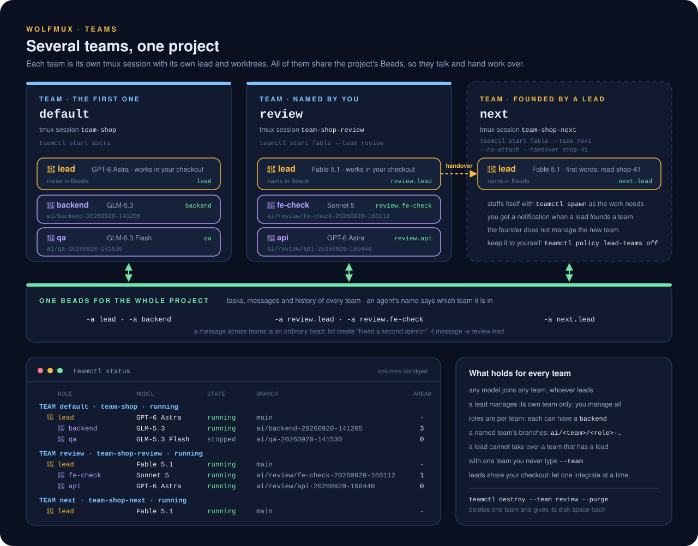

# Usage

The installed user manual is [`config/wolfmux/README.md`](../config/wolfmux/README.md)
(`~/.config/wolfmux/README.md` on the machine). This page walks through one
complete session and lists every command.

## A complete session

```bash
cd ~/code/shop
teamctl start fable              # or: teamctl start astra
```

You are now attached to a tmux session with one pane, `lead · Fable 5.1`. Tell the
lead what you want, for example *"Add password reset. Backend and frontend in
parallel, QA afterwards."* The lead then works like this (you can type the same
commands yourself at any time):

```bash
# 1. plan: tasks with owners, acceptance criteria and dependencies
bd create "Reset API: POST /reset, POST /reset/confirm" -t task -p 1 -a backend --body-file api-spec.md
bd create "Reset screens" -t task -p 1 -a frontend -d "Two screens, contract in the API task"
bd create "E2E: reset flow" -t task -p 2 -a qa -d "Happy path + expired token"
bd dep add <qa-task> <api-task>
bd dep add <qa-task> <ui-task>

# 2. staff: one pane, branch and worktree each
teamctl spawn backend glm53
teamctl spawn frontend glm53
teamctl spawn qa flash
```

Each worker boots, reads its inbox, claims its task and starts. They coordinate
directly:

```bash
# in the frontend pane
bd create "Need expires_at in the confirm response" -t message -a backend -d "ISO-8601, UTC"
# backend's pane shows:  [wolfmux] Beads update for backend (shop-wisp-x1). Run: bd show shop-wisp-x1 ...
```

When a worker finishes it commits, reports and closes:

```bash
git commit -am "feat: password reset API"
bd create "Done: Reset API" -t message -a lead --body-file report.md   # summary, tests, commit, risks
bd close <api-task> -r "commit 4f2a9c1; 38 tests pass"
```

The lead is notified, reviews and integrates:

```bash
teamctl status                       # who is running, commits ahead, dirty files
teamctl diff backend --stat          # then: teamctl diff backend
git cherry-pick 4f2a9c1              # in the project root — only the lead does this
bd create "Changes requested: rate-limit /reset" -t message -a backend -d "…"   # or this
```

End of day:

```bash
teamctl destroy                      # stops the panes; branches, commits and Beads stay
teamctl destroy --worktrees          # later: drops clean worktrees and fully merged ai/* branches
```

## Several teams in one project



```bash
teamctl start astra                       # the first team ("default")
teamctl start fable --team review         # a second one, named by you, in its own tmux session
teamctl spawn fe-check sonnet --team review
teamctl status                            # every team: TEAM, its 🐺 lead, its 🐶 teammates
teamctl teams                             # the short list
teamctl attach --team review              # each team opens in its own terminal tab
teamctl destroy --team review --worktrees
```

| Rule | |
|------|---|
| naming | lowercase letters, digits, `-`, 50 characters at most; `--team <name>` may stand before or after the command |
| which team a command means | inside a pane: the agent's own team. At your terminal: the only team there is; with several, the command lists them and asks (`status` and `teams` show all) |
| `teamctl start <model>` without `--team` | the first team. If that is running under another model it is not opened for you; you are shown `teamctl attach` and `teamctl start <model> --team <name>` |
| roles | per team: two teams can each have a `backend`. Branches are `ai/<team>/<role>-…`, worktrees live under `…/teams/<team>/` |
| Beads | all teams share the project's Beads. The first team's agents are `lead`, `backend`, …; a named team's are `review.lead`, `review.backend`. Hand work across teams with `-a review.lead` |
| management | a lead manages its own team only; you manage all |
| your checkout | teammates are apart in worktrees, leads are not: every lead works in your checkout, on the branch that is checked out there. Let one lead integrate at a time |

## Disk: what a lane costs, and how it is given back

One lane worktree on this project carried 2.3 GB of `node_modules`, 0.9 GB of `.next` and
half a gigabyte of copied assets. Nothing used to remove any of it: not stopping the lane,
not parking it for a week. 27 parked lanes of one project reached 65 GB, `~/.wolfmux`
reached 102 GB, and the machine filled its disk and rebooted three times with every team's
work in flight. So teamctl cleans up after its own worktrees.

```bash
teamctl status                       # free disk, and what this team's lanes take
teamctl teams                        # measures it, team by team (a du per lane)
teamctl prune --dry-run              # what the parked lanes hold, deleting nothing
teamctl prune                        # take it
teamctl prune --keep-node-modules    # build caches only, so a restart stays cheap
```

Who takes what:

| Command | Takes |
|---------|-------|
| `teamctl stop <role>` | `.next`, `dist`, `.turbo`, `build`, `coverage`, `.cache`, `.parcel-cache`, `.vite`, `.svelte-kit`, `.nuxt`, `target`. **Not** `node_modules`: `teamctl restart` has to stay the cheap thing it looks like |
| `teamctl prune` | the same list **and** `node_modules`, for every parked lane. A parked lane is what hoards |
| `teamctl remove <role>`, `teamctl destroy --worktrees` | all of it; the worktree is going away anyway |

Five rules hold for every one of those deletions, and they are in one place
(`config/wolfmux/lib/disk.sh`):

1. only a name on that one list — a directory a build command makes again from the sources;
2. never a path git tracks in that worktree, whatever it is called (a project that commits
   its `dist` keeps it);
3. never a worktree with uncommitted changes to tracked files, or untracked files that are
   not themselves build output: it is skipped, and the skip is printed with the reason;
4. never a running lane, never your own checkout, and only inside a worktree wolfmux made
   for that project and team — every path resolved with `pwd -P` and checked against that
   prefix, so an edited record or a symlink leading out cannot aim a deletion elsewhere;
5. `--dry-run` prints the same report and deletes nothing.

A lane that lost its `node_modules` still has every source file and all of its git state;
it needs one `npm install` (or whatever the project installs with) before its tools run
again. Each directory is renamed inside its own worktree before it is deleted, and a rename
is one atomic step, so a cleanup killed halfway leaves a `.wolfmux-removing-*` directory
that the next run clears — never a `node_modules` that is half there and looks installed.

**The guard.** `teamctl spawn` checks free disk before it makes anything. Under
`disk-min-gb` (default 20) it refuses and names the number; `teamctl policy disk-guard warn`
makes it a warning instead, `off` removes the check, and `teamctl policy disk-min-gb <n>`
moves the limit (`0` = no limit).

**Sharing one node_modules.** `teamctl spawn <role> <model> --link-node-modules` points the
new lane's `node_modules` at the project root's copy instead of letting it install 2+ GB of
its own; `teamctl policy link-node-modules on` does it for every spawn. It is off by default
for a reason: that is ONE directory for every lane and for your own checkout, so an
`npm install` in any lane changes the dependencies of all of them, and two lanes that need
different versions of a package cannot both be right.

**Why `teamctl status` never measures.** A `du` over one lane's `node_modules` walks tens of
thousands of files, and over 27 lanes it takes seconds. `status` runs every few minutes, so
it only reads the number that the last command to change the lanes left behind (and says
"not measured" when there is none). `teamctl teams` is the command that measures.

## Deleting a team, and what a team costs

| What | Disk |
|------|------|
| each worker | a checkout of your tracked files, plus whatever it installs or builds inside (`node_modules`, `.venv`, build output). `.git` is shared, never copied |
| the lead | nothing: it works in your own checkout |
| teamctl's records | a few KB per team |
| the agents' Claude Code transcripts | some MB, under `~/.claude/projects/` |
| tmux | memory only (scrollback) |

`teamctl teams` shows DISK per team.

```bash
teamctl destroy --team review --purge      # look, ask, then delete the whole team
```

It prints every worker with its size, its uncommitted files and the commits your branch
does not have, and the total it frees, and has touched nothing at that point. If work
would be lost you are asked with that list in front of you; `--force` deletes anyway; with
nobody to ask and no `--force` it refuses and the team keeps running. Gone afterwards:
the session, every worktree, the team's `ai/…` branches, its records, its teammates' Claude
Code transcripts (`--keep-transcripts` keeps those). Never touched: your checkout, other
branches, Beads, other teams, the lead's own conversations (they live in your checkout's
folder under `~/.claude/projects/`), Codex's sessions.

## Teams working together

All teams of a project share its Beads, so they can talk: `-a review.lead` reaches the lead
of team review, a plain `-a lead` the first team's. A lead can also found a team and hand
work over, without you relaying anything:

```bash
bd create "Handover: payments" -t message -a next.lead --body-file handover.md    # → id shop-41
teamctl start fable --team next --no-attach --handover shop-41
```

The new lead starts by reading that bead, you get a notification, and the founder does not
manage the new team. `teamctl policy lead-teams off` keeps founding teams to yourself. A
lead can never take over a team that already has a lead; a worker can never found one.

## teamctl

| Command | Does |
|---------|------|
| `teamctl start <model> [--team <name>] [--no-attach] [--continue] [--init-beads\|--skip-beads] [--lead-permissions …] [--worker-permissions …] [--worker-spawn …]` | create the session and the lead pane; attach. Any model can lead (table below). `--team` names a further team; `--continue` resumes the lead's last conversation. With a team already there: see [closing and coming back](#finding-the-manager-and-being-told-when-someone-finishes) |
| `teamctl start <model> --team <new> --handover <bead-id>` | found a fresh team whose lead starts by reading that bead ([teams working together](#teams-working-together)) |
| `teamctl policy [<key> <value>]` | show or change, per team: `lead-permissions` (skip\|ask), `worker-permissions` (skip\|lead\|ask), `worker-spawn` (on\|off), `worker-isolation` (on\|off: the worktree guard), `lead-teams` (on\|off: may the lead found teams), `disk-guard` (refuse\|warn\|off), `disk-min-gb` (a whole number of GB, 0 = no limit), `link-node-modules` (on\|off) |
| `teamctl approvals [--all]`, `teamctl approve <id>…\|--all`, `teamctl deny <id> "<reason>"` | the lead decides workers' permission requests (`worker-permissions lead`) |
| `teamctl spawn <role> <model> [--base <ref>] [--no-kickoff] [--link-node-modules]` | new worker: branch + worktree + pane. Any model, whoever leads (table below). Refused when free disk is under `disk-min-gb`. `--link-node-modules`: the lane shares the project root's `node_modules` instead of installing its own ([disk](#disk-what-a-lane-costs-and-how-it-is-given-back)) |
| `teamctl stop <role>` | close a pane; worktree, branch and commits stay. Its build caches go, `node_modules` stays |
| `teamctl remove <role>... [--force] [--yes]` | take a stopped worker off the books: worktree, branch, record and the gigabytes they held. Refuses when the worker holds uncommitted files or commits your branch does not have, and lists them; `--force` discards them after one question |
| `teamctl prune [--team <name>] [--dry-run] [--keep-node-modules]` | the build output of every parked lane of the team, with a total in GB. Running lanes untouched; `--dry-run` deletes nothing; `--keep-node-modules` takes the build caches only ([disk](#disk-what-a-lane-costs-and-how-it-is-given-back)) |
| `teamctl restart <role> [--continue]` | same worktree and branch; `--continue` resumes the CLI's last conversation |
| `teamctl nudge <role>\|--all [--id <bead>] [--quiet]` | re-send the one-line notification. `--quiet`: nobody to notify is not an error (what the Beads hook passes) |
| `teamctl status [--json]` (alias `workers`) | team by team: role, model, running / exited(N) / stopped, pane, branch, commits ahead, dirty files, plus free disk and what the team's lanes take |
| `teamctl teams` | the short list per team: state, lead, number of agents, the disk its teammates' worktrees take, session. This is the command that measures that disk |
| `teamctl panes` | tmux's view: command, pid, cwd |
| `teamctl capture <role> [-n\|--lines N] [--all]`, `teamctl log <role>` | recent / full terminal output — for diagnosing a stuck agent, never for task state |
| `teamctl focus <role>`, `teamctl attach` (alias `open`) | move your terminal |
| `teamctl layout [lead-left\|lead-top\|tiled]` | how the panes are arranged, for this team; `lead-left` is the default |
| `teamctl worktrees` | branch, commits ahead, dirty count per worker |
| `teamctl diff <role> [--stat\|--names\|--commits\|--working]` | the worker's changes since its base |
| `teamctl destroy [--worktrees] [--yes]` | end the session; never deletes dirty worktrees, unmerged branches, source, credentials or Beads data |
| `teamctl destroy --purge [--force] [--keep-transcripts] [--yes]` | delete the whole team and free its disk space: reports first, asks, then removes session, worktrees, `ai/…` branches, records and its teammates' Claude Code transcripts ([deleting a team](#deleting-a-team-and-what-a-team-costs)) |
| `teamctl doctor` | launcher, credential, settings and login checks |

Roles are lowercase letters, digits and `-` (max 32). `lead` is reserved.
`start`, `stop`, `restart`, `remove`, `destroy`, `approve`, `deny` and changing the `policy`
are reserved for the lead of that team and for you; `spawn` too unless `worker-spawn` is on.
A worker gets exit 77. `--team <name>` goes with any command, before or after it.
`teamctl send|inbox|broadcast|task` print the `bd` equivalents.

### Models

| Model key | Runs | Pays with |
|-----------|------|-----------|
| `glm53` · `flash` | Claude Code + GLM-5.3 / GLM-5.3 Flash | Z.ai GLM Coding Plan — the default for workers |
| `kimi` | Claude Code + Kimi for Coding | Kimi for Coding subscription |
| `minimax` | Claude Code + MiniMax M3 | MiniMax Coding Plan |
| `qwen` | Claude Code + Qwen 3.7 Plus | Alibaba Model Studio coding plan |
| `moonshot` | Claude Code + Kimi K3 API | Moonshot platform API: metered, off until the owner sets `WOLFMUX_METERED=on` |
| `deepseek` | Claude Code + DeepSeek V4 | DeepSeek API: metered, off until the owner sets `WOLFMUX_METERED=on` |
| `fable` · `opus` · `sonnet` · `haiku` | Claude Code + that Claude model | Claude subscription |
| `astra` | Codex CLI + GPT-6 Astra | ChatGPT / Codex subscription |
| `claude:<model-id>` · `codex:<model-id>` | any other model of those two subscriptions | the same subscription |
| `kimi:<id>` · `moonshot:<id>` · `deepseek:<id>` · `minimax:<id>` · `qwen:<id>` | any other model id of that provider (GLM is not pinnable) | the same plan, or the same metered account |

A Fable team can take on an Astra teammate for one review (`teamctl spawn fe-review astra`),
an Astra team a Sonnet one (`teamctl spawn summary sonnet`), any team a Kimi one
(`teamctl spawn docs2 kimi`); tell the lead, or run it
yourself. Every teammate gets its own worktree and branch and the same Beads inbox. What
differs by CLI: Claude-based teammates have the worktree guard and the lead-approval mode;
Codex-based ones have neither (Codex has no such hooks) but do send notifications.

A provider worker needs its key in the Keychain first
([SETUP.md](SETUP.md#3-the-keys)); `teamctl doctor` says which are set up. `spawn` and
`start` refuse a metered key (exit 77, and the launcher exit 78) until the owner has set
`WOLFMUX_METERED=on`; `teamctl status` marks a running metered agent with `$` after its
label, with a legend line under the table.

## Beads cheat sheet

```bash
bd list --assignee $BEADS_ACTOR --status open,in_progress,blocked --include-infra   # inbox: your tasks (new, claimed, blocked) + unread messages; $BEADS_ACTOR is your role, or <team>.<role> in a named team
bd show <id>                  bd show <id> --thread           # read; whole conversation
bd close <id> -r read                                         # mark a message read
bd create "Subject" -t message -a <role> -d "body"            # send        (--body-file for long text)
bd create "Re: …" -t message -a <role> -d "…" --deps replies-to:<id>        # reply
bd create "Title" -t task -p 1 -a <role> -d "…"               # assign work
bd update <id> --claim        bd update <id> --status blocked # I'm on it / I'm stuck
bd close <id> -r "commit <sha>; tests pass"                   # done
bd update <id> --add-label failed && bd close <id> -r "FAILED: why"
bd ready                      bd list --status in_progress,blocked
bd list --type message --all                                  # message history
```

Status map: pending = open without assignee · assigned = open with assignee ·
in_progress · blocked · completed = closed · failed = closed + label `failed`.
Comments (`bd comment`) notify nobody; send a message when someone must act.

## Finding the manager, and being told when someone finishes

| You see | Meaning |
|---------|---------|
| the lead large on the left, teammates stacked on the right | the default arrangement. `teamctl layout lead-top` or `tiled` changes it for this team (`WOLFMUX_LAYOUT` for all); inside the team `Ctrl-b Space` cycles tmux's own arrangements and `Ctrl-b T` puts the last one back |
| a popup with the wolf when you open the team | `teamctl start` / `attach` worked. Any key closes it (or 3 seconds). Off: `WOLFMUX_SPLASH=off` in `~/.config/wolfmux/config` |
| `🐺 lead · <model>` and an amber pane border | the manager. Teammates are `🐶 <role> · <model>` with grey borders (blue when focused) |
| `🐺 WOLFMUX` in the status line, `🐺 <session>` as the tab title | this terminal tab is a Wolfmux team |
| a desktop notification `🐺 lead: …` or `🐶 backend: …` | that agent finished a turn. Click it: if the team is open in a tab, that tab comes to the front; if it is on no screen, a new terminal window opens attached to it (the notification then comes from **Wolfmux**, with the wolf as its icon). The first time, macOS asks to allow Wolfmux notifications and to let Wolfmux control your terminal: allow both. Scope: `WOLFMUX_NOTIFY=all` (default), `lead`, or `off`; terminal: `WOLFMUX_TERMINAL=iterm\|terminal` |

**Clearing up.** `teamctl destroy` ends the team and keeps every worktree. `teamctl destroy
--worktrees` also removes the workers that hold nothing: clean worktree, branch fully merged.
A worker that still holds work is kept and named, with the two ways out: `git merge <branch>`
to keep it, `teamctl remove <role> --force` to discard it.

**Staying in lane.** Each teammate works in its own worktree on its own branch, and a guard
refuses tool calls that reach outside (changing the lead's checkout, reading a teammate's
worktree, switching or deleting branches, pushing to main, tmux). The refusal tells the
worker to ask the lead. `teamctl policy worker-isolation off` turns it off for a project.

**Closing and coming back.** Quitting an agent's CLI leaves its pane on screen (so you can
read its last output); quitting all of them leaves a window of finished panes. `teamctl start
<fable|astra>` deals with both: if only the lead had exited it comes back in its place and the
workers are not touched; if everyone had exited, the old window is cleared and a new session
starts. Workers from before are listed as stopped, with their worktrees — `teamctl restart
<role> --continue` brings one back with its conversation. `teamctl start … --continue` does
the same for the lead. After a reboot no tmux session is left at all: `teamctl restart lead
--continue` (with `--team <name>` for a named team) starts the team again in the lead's last
conversation, then `restart` each teammate. To end a team on purpose: `teamctl destroy`.

Notifications and the session names (`🐺 team/lead`, `🐶 team/<role>`) reach an agent when it starts:
after an update, `teamctl restart <role> --continue`.

## tmux, in the team session only

Mouse: click to focus, drag a border to resize, wheel to scroll. `Ctrl-b` then
arrows = move · `Ctrl`/`Alt`-arrows = resize · `z` = zoom · `T` = re-tile ·
`q` = pane numbers · `d` = detach (the team keeps running).

## Checking which model and account a pane really uses

| Pane | Type | Expect |
|------|------|--------|
| Fable lead | `/status` | Claude subscription login, no API key, no custom base URL |
| Astra lead | `/status` | signed in with ChatGPT, model `gpt-6-astra` |
| GLM worker | `/status` | base URL `https://api.z.ai/api/anthropic`, auth `apiKeyHelper` (or `ANTHROPIC_AUTH_TOKEN` in env mode), model `glm-5.3` / `glm-5.3-flash` |
| other provider worker | `/status` | that provider's base URL and model (Kimi auth may be `ANTHROPIC_API_KEY` in env mode); `WOLFMUX_DRY_RUN=1 claude-<provider>` prints the exact values |
