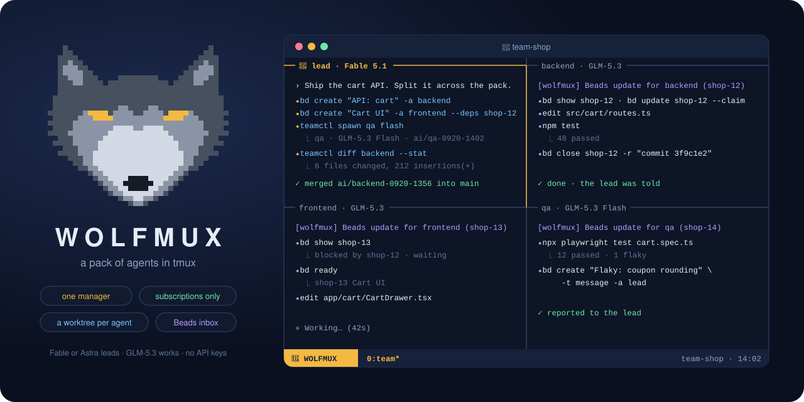
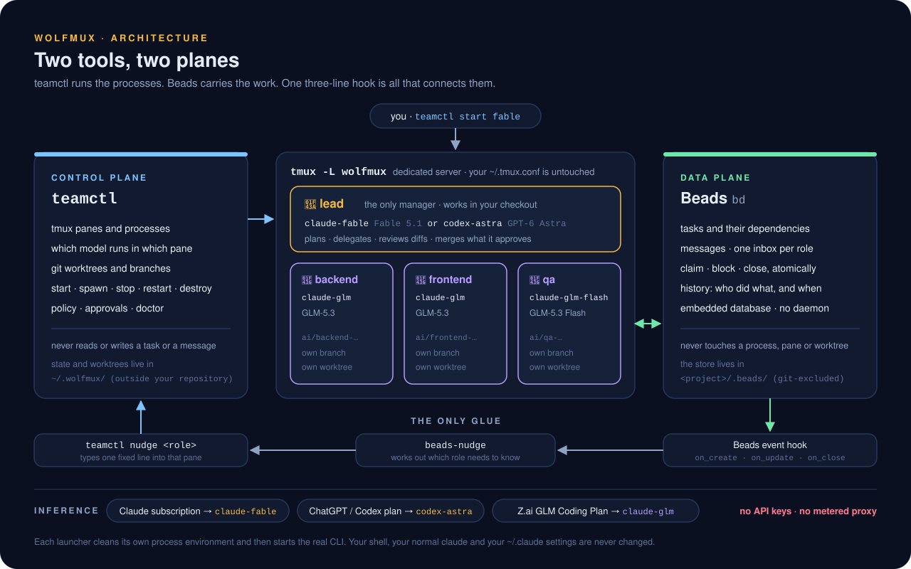
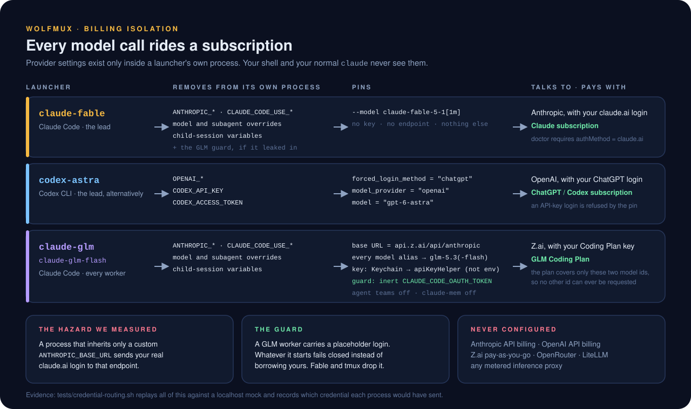
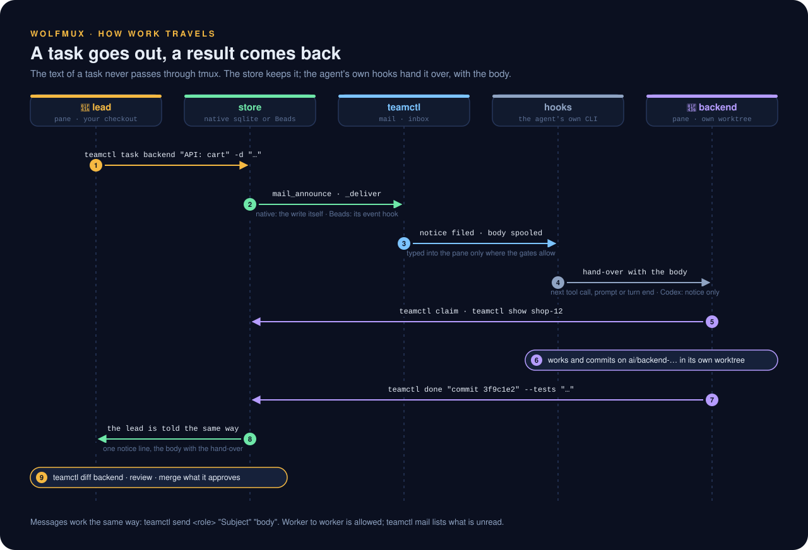
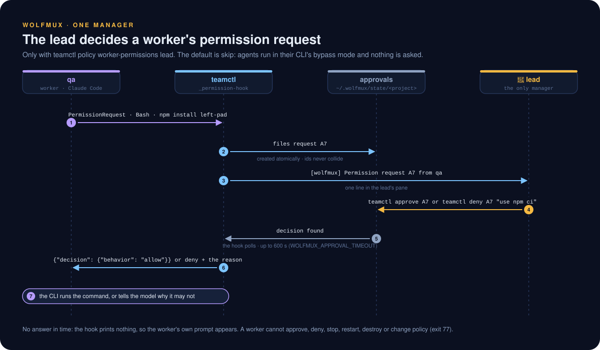
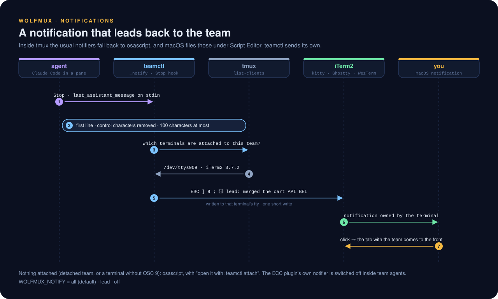

# Diagrams

Every diagram in one place. They are plain SVG with their own dark background, so they
look the same in GitHub's light and dark themes, and each carries a `<title>` and
`<desc>` for screen readers.

## The pack at work

## Architecture — two tools, two planes

`teamctl` runs processes; Beads carries the work; one hook connects them.
Details: [ARCHITECTURE.md](../ARCHITECTURE.md).

## Billing isolation — every model call rides a subscription

What each launcher removes from its own process, what it pins, and who gets paid.
Details and evidence: [SECURITY.md](../SECURITY.md).

## How work travels

A task goes out through Beads, one fixed line reaches the worker's pane, the result
comes back the same way. The text of a task never passes through tmux.

## The lead decides a worker's permission request

Only with `teamctl policy worker-permissions lead`; the default is `skip`.

## A notification that leads back to the team

Why clicking a Wolfmux notification opens your terminal and not Script Editor.

## The wolf

## Changing them

| File | Source | Regenerate |
|------|--------|------------|
| `wolf.svg`, the wolf inside `hero.svg`, the terminal art in `config/wolfmux/lib/brand.sh` | the pixel bitmap in `tools/wolf-art.py` | `tools/wolf-art.py install` |
| `message-flow.svg`, `approval-flow.svg`, `notification-flow.svg` | the specs at the top of `tools/flow-diagrams.py` | `tools/flow-diagrams.py` |
| `hero.svg`, `architecture.svg`, `billing-isolation.svg` | hand-written SVG | edit the file |

Palette: night `#0b1020`, panel `#111a2e`, line `#26365a`, text `#e6edf7`, muted
`#8fa3c2`; amber `#f5b942` is the lead, violet `#b69cff` the workers, ice `#7cc4ff`
`teamctl`, green `#6ee7a8` Beads and subscriptions, coral `#ff7a90` what never happens.
System font stacks only: an SVG shown through `` cannot load a web font.
